# Aapli Admin design system

**Status:** v2.7.2 · adopted 15/10/2026, updated 18/10/2026
**Applies to:** the admin console (left navigation) and the form builder. Every new admin screen, and every change to an existing one, must follow this document.
**Code:** `src/scss/design-system/` (tokens and shared classes) and `src/app/_view/_ui-components/side-nav/` (left navigation).
**Reference prototype:** *Application Custom Properties* (Admin › Form Builder › Properties). This system is drawn from it.

> If the code and this document disagree, that is a bug. Fix whichever is wrong in the same pull request, and record the change in the [changelog](#13-changelog).

> Illustrated copy of AapliAdmin `docs/DESIGN_SYSTEM.md` (branch `redesign`). The diagrams are drawn from the `--ab-*` tokens; regenerate with `_design-src/admin/`. Edit the AapliAdmin file, not this one.

---

## Contents

1. [Principles](#1-principles)
2. [Foundations](#2-foundations): colour, typography, spacing, shape, icons, motion, layering, breakpoints
3. [Layout](#3-layout): page, shell, app bar, main tabs, body, pane, aside, action bar
4. [Left navigation](#4-left-navigation)
5. [Section rail](#5-section-rail)
6. [Components](#6-components): headings, buttons, form fields, selection controls, tables, data table, chips and badges, cards, settings sections, feature list and detail panel, notes, code and API preview, status flag, toast, empty, loading and error states, dialogs (modal confirmation), stats, accordions
7. [Patterns](#7-patterns): editing and saving, validation, destructive actions, search and filter
8. [Content and copy](#8-content-and-copy)
9. [Accessibility](#9-accessibility)
10. [Implementing in Angular](#10-implementing-in-angular)
11. [Pull request checklist](#11-pull-request-checklist)
12. [Adoption status and known gaps](#12-adoption-status-and-known-gaps)
13. [Changelog](#13-changelog)

---

## 1. Principles

1. **Quiet chrome, clear content.** Surfaces are white or near-white, separated by 1px hairlines. No drop shadows, gradients or heavy fills. Colour is kept for meaning: the primary action, the current location, and status.
2. **One accent.** The brand blue (`--ab-primary`) marks what is selected, active or primary. If everything is blue, nothing is.
3. **Tell people what will happen.** Every setting has a plain-language subtitle. Where a setting affects behaviour elsewhere (an API response, a feature switch), show the effect next to it, as the API preview in the prototype does.
4. **Never lose work silently.** Show whether there are unsaved changes, say why Save is unavailable, and confirm before discarding.
5. **Keyboard and screen reader first-class.** Every interactive element is a real `<button>` or `<a>`, has a visible focus ring, and has an accessible name.
6. **Tokens, not values.** Colours, sizes and spacing come from `--ab-*` tokens. A raw hex value or a one-off pixel size in a component stylesheet needs a reason in a comment.

---

## 2. Foundations

All tokens are CSS custom properties defined on `:root` in `src/scss/design-system/_tokens.scss`. They are prefixed `--ab-` so they never collide with Bootstrap, Angular Material or the tenant theme variables (`--primaryColor` and so on).

### 2.1 Colour

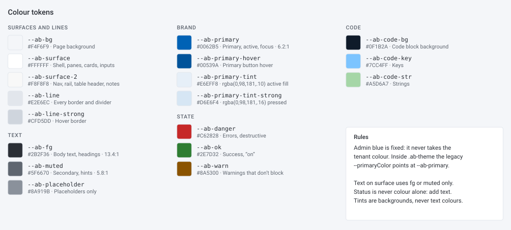

The admin uses a **fixed brand blue** (`#0062b5`). It does not follow the tenant's theme colour: tenants theme what their users see, not the admin tool. Inside an `.ab-theme` container the legacy `--primaryColor` and `--primaryColorRGBA` variables are re-pointed at the admin blue, so older markup inside a redesigned screen follows along.

#### Surfaces and lines

| Token | Value | Use |
|---|---|---|
| `--ab-bg` | `#f4f6f9` | Page background behind the shell; background of tab bodies that hold cards |
| `--ab-surface` | `#ffffff` | Shell, panes, cards, inputs |
| `--ab-surface-2` | `#f8f8f8` | One step down: left nav, section rail, table headers, notes, disabled inputs |
| `--ab-line` | `#e2e6ec` | Every border and divider |
| `--ab-line-strong` | `#cfd5dd` | Hover border on inputs and stroked buttons |

#### Text

| Token | Value | Use |
|---|---|---|
| `--ab-fg` | `#2b2f36` | Body text and headings |
| `--ab-muted` | `#5f6670` | Secondary text, subtitles, hints, inactive tabs and nav items (5.8:1 on white) |
| `--ab-placeholder` | `#8a919b` | Input placeholders only. Never for text people need to read |

#### Brand and state

| Token | Value | Use |
|---|---|---|
| `--ab-primary` | `#0062b5` | Primary buttons, active tab, active nav item, links, focus ring, checked controls |
| `--ab-primary-hover` | `#00539a` | Hover on primary buttons |
| `--ab-primary-tint` | `rgba(0,98,181,.10)` | Background of the active nav or rail item, primary chips |
| `--ab-primary-tint-strong` | `rgba(0,98,181,.16)` | Pressed or selected-and-hovered states |
| `--ab-primary-rgb` | `0, 98, 181` | For `rgba(var(--ab-primary-rgb), x)` when another alpha is needed |
| `--ab-on-primary` | `#ffffff` | Text and icons on primary |
| `--ab-danger` / `--ab-danger-tint` | `#c62828` / `rgba(198,40,40,.08)` | Errors, invalid fields, destructive hover |
| `--ab-ok` / `--ab-ok-tint` | `#2e7d32` / `rgba(46,125,50,.10)` | Success, "on" status, HTTP method labels |
| `--ab-warn` / `--ab-warn-tint` | `#8a5300` / `rgba(237,160,0,.12)` | Warnings that need attention but do not block |

#### Code

| Token | Value |
|---|---|
| `--ab-code-bg` | `#0f1b2a` |
| `--ab-code-fg` | `#d6e4f5` |
| `--ab-code-key` | `#7cc4ff` |
| `--ab-code-str` | `#a5d6a7` |

**Rules**

- Text on `--ab-surface` or `--ab-surface-2` uses `--ab-fg` or `--ab-muted`. Nothing lighter.
- Status is never shown by colour alone. Pair it with text or an icon (for example "Export to IF tab: shown" next to a green dot).
- Tints are backgrounds only. Do not put tinted text on a tinted background of the same hue except in chips, where the text uses the full-strength colour.
- Dark mode is not supported yet. The prototype's dark values are kept in the prototype for reference. When it is added, it will be a second set of token values only; no component should need changing, which is another reason never to hard-code colours.

### 2.2 Typography

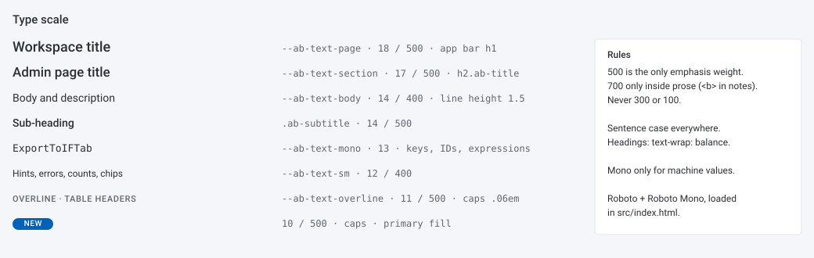

| Token | Value |
|---|---|
| `--ab-font-ui` | `"Roboto", system-ui, -apple-system, "Segoe UI", sans-serif` |
| `--ab-font-mono` | `"Roboto Mono", ui-monospace, Consolas, monospace` |

Both are loaded from Google Fonts in `src/index.html` (Roboto 300/400/500/700, Roboto Mono 400/500).

#### Type scale

| Role | Token | Size | Weight | Line height | Notes |
|---|---|---|---|---|---|
| Workspace title (app bar `h1`) | `--ab-text-page` | 18px | 500 | 1.25 | Full-screen editors only (form builder) |
| **Admin page title** (`h2.ab-title`) | `--ab-text-section` | **17px** | **500** | 1.25 | First line of every admin screen; see [3.6](#36-page-frame-and-title) |
| Admin page description (`p.ab-sub`) | `--ab-text-body` | 14px | 400 | 1.5 | Under the page title, `--ab-muted`, full width of the section |
| Sub-heading (`.ab-subtitle`) | `--ab-text-body` | 14px | 500 | 1.5 | Groups inside a section |
| Body | `--ab-text-body` | 14px | 400 | 1.5 | Default for everything |
| Mono input / code | `--ab-text-mono` | 13px | 400 | 1.5 | Keys, IDs, expressions |
| Small | `--ab-text-sm` | 12px | 400 | 1.45 | Hints, errors, counts, chips, status |
| Overline (`.ab-overline`, `th`) | `--ab-text-overline` | 11px | 500 | 1.4 | UPPERCASE, `letter-spacing: .06em` |
| Badge | — | 10px | 500 | 1.6 | UPPERCASE, `letter-spacing: .06em` |

**Rules**

- **500 is the only emphasis weight** in UI: headings, active items, buttons. Use 700 (`<b>`) only inside running prose such as notes.
- Never use 300 (light) or 100 for text.
- Subtitles and descriptions (`.ab-sub`, panel and section descriptions) run the full width of their section. Only notes (`.ab-note`) keep a 70ch cap.
- Headings use `text-wrap: balance`.
- Sentence case everywhere: "Custom properties", not "Custom Properties". (Existing screen names are being migrated; new text must be sentence case.)
- Mono is for machine values: keys, IDs, endpoints, expressions, JSON. Not for emphasis.

### 2.3 Spacing

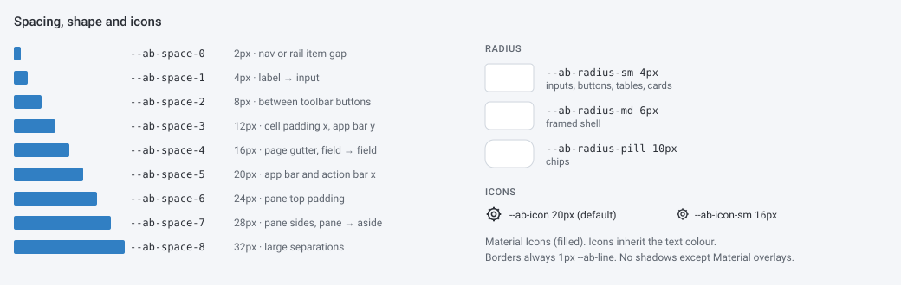

A 4px grid. Use the tokens; a value off the grid needs a comment.

| Token | Value | Typical use |
|---|---|---|
| `--ab-space-0` | 2px | Gap between stacked nav or rail items |
| `--ab-space-1` | 4px | Label to input, title to subtitle |
| `--ab-space-2` | 8px | Between buttons in a toolbar, icon to text in dense rows |
| `--ab-space-3` | 12px | App bar vertical padding, table cell horizontal padding |
| `--ab-space-4` | 16px | Page gutter, field to field, note padding |
| `--ab-space-5` | 20px | App bar and action bar horizontal padding |
| `--ab-space-6` | 24px | Pane top padding |
| `--ab-space-7` | 28px | Pane side padding, gap between pane and aside |
| `--ab-space-8` | 32px | Large separations |

Fixed component paddings that come from the prototype (and are already in the classes, so you do not repeat them): nav and rail items `9px 12px`; inputs `7px 9px`; buttons `7px 14px`; table header cells `8px 12px` (36px row), body cells `6px 12px` (40px row, see [Row height](#row-height)); main tabs `12px 14px`.

### 2.4 Shape, borders and elevation

| Token | Value | Use |
|---|---|---|
| `--ab-radius-sm` | 4px | Inputs, buttons, nav and rail items, tables, notes, code, cards |
| `--ab-radius-md` | 6px | The framed shell |
| `--ab-radius-pill` | 10px | Chips |

- Borders are always `1px solid var(--ab-line)`.
- Separation comes from borders and the `bg` / `surface` / `surface-2` steps, **not shadows**. The only shadows allowed are the ones Angular Material puts on overlays (menus, dialogs, tooltips).
- A selected card gets a 3px inset bar on its left in `--ab-primary` (see [Cards](#67-cards--ab-card)).

### 2.5 Icons

- **Material Icons** (filled), as already loaded by the app. Use `<mat-icon>` or `<span class="material-icons">`.
- Sizes: `--ab-icon` (20px) by default; `--ab-icon-sm` (16px) in overlines and dense metadata.
- Icons sit to the left of their label with a 6–10px gap. Chevrons and "open" arrows sit on the right.
- **Icons take the colour of the text around them** (`color: inherit` inside `.ab-theme`): white on a primary button, red in a danger menu item, primary in an active tab. Never let the app-wide `.mat-icon { color: var(--iconColor) }` paint an icon dark grey on a coloured background. Give an icon its own colour only for meaning (a green check in a list of what an app adds).
- Decorative icons get `aria-hidden="true"`. An icon-only button must have `aria-label` and a tooltip.
- One icon means one thing across the admin. Current assignments:

| Concept | Icon |
|---|---|
| Add | `add` |
| Remove / delete row | `delete_outline` |
| Save | `save` |
| Preview | `visibility` |
| Close | `close` |
| Search | `search` |
| Back / next | `arrow_back` / `arrow_forward` |
| Expand group | `expand_more` (rotates 180° when open) |
| Collapse / expand nav | `menu_open` / `menu` |
| API / endpoint | `api` |
| Success toast | `check_circle` |
| Locked / not available | `lock` |
| Form builder tabs | Settings `settings` · Form `design_services` · Request workflow `account_tree` · Response workflow `alt_route` · Tasks `assignment` · Dashboard `space_dashboard` |
| Settings rail | Application settings `tune` · Information `info` · Views `dashboard` · Roles and permissions `security` · Other settings `settings` · Points `star` · AI features `smart_toy` · Integrations `integration_instructions` · Custom properties `data_object` |

### 2.6 Motion

- `--ab-duration: .2s` with `--ab-ease: cubic-bezier(.2, 0, 0, 1)` for colour, border and small transforms (chevrons, nav width).
- No entrance animations on page content. Tabs switch instantly (`animationDuration="0ms"`).
- Everything respects `prefers-reduced-motion: reduce`; the shared stylesheet turns transitions off inside `.ab-theme`.

### 2.7 Layering

| Token | Value | Use |
|---|---|---|
| `--ab-z-sticky` | 20 | Sticky action bars and headers |
| `--ab-z-toast` | 1000 | Toasts |

Exception: the form builder footer keeps `z-index: 9999`, because the Design and Workflow canvases stack their own layers high. Do not copy this elsewhere.

### 2.8 Breakpoints

| Width | Behaviour |
|---|---|
| > 1100px | Pane and aside side by side |
| ≤ 1100px | Aside drops below the pane |
| ≤ 760px | Section rail becomes a horizontal scrolling row above the pane; pane padding reduces to `18px 14px`; app bar chips are hidden |

The admin is a desktop tool, but nothing may scroll horizontally at page level at any width. Wide tables scroll inside `.ab-table-wrap`.

---

## 3. Layout

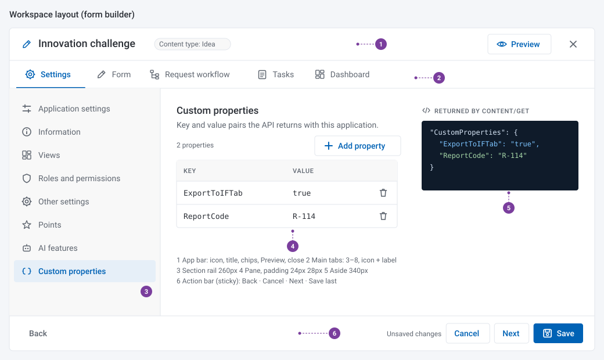

```
┌──────────────────────────────────────────────────────────────────────────────┐
│ LEFT NAV │  ┌ SHELL ─────────────────────────────────────────────────────┐   │
│ (264px / │  │ APP BAR   [icon] Title  (chip)              [Preview] [x]  │   │
│  64px)   │  ├────────────────────────────────────────────────────────────┤   │
│          │  │ MAIN TABS  Overview  Design  Workflow  Tasks  Properties   │   │
│ Search   │  ├──────────┬─────────────────────────────────────────────────┤   │
│ ▸ Group  │  │ SECTION  │ PANE                          │ ASIDE (340px)   │   │
│ ▾ Group  │  │ RAIL     │ h2 Title                      │ OVERLINE        │   │
│    Item  │  │ (260px)  │ Subtitle                      │ preview / help  │   │
│    Item  │  │          │ [toolbar]                     │                 │   │
│ ▸ Group  │  │          │ content                       │                 │   │
│          │  ├──────────┴─────────────────────────────────────────────────┤   │
│          │  │ ACTION BAR  [Back]                [Cancel] [Next] [Save]   │   │
│          │  └────────────────────────────────────────────────────────────┘   │
└──────────────────────────────────────────────────────────────────────────────┘
```

Not every screen uses every region. A simple settings screen is: left nav → pane (title, subtitle, content, inline action bar).

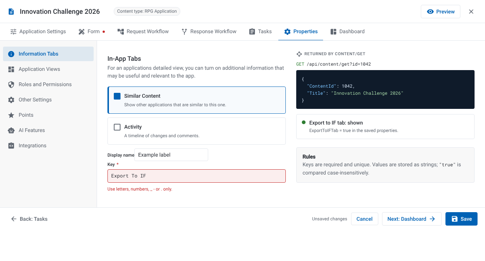

*Reference render of the shell (form builder › Properties) with fictional data.*

### 3.1 Theme root — `.ab-theme`

Put `.ab-theme` on the outermost element of a redesigned screen. It:

- sets the Roboto type, 14px base size, `--ab-fg` text colour and a box-sizing reset;
- re-points `--primaryColor`, `--primaryColorRGBA` and `--paragraphColor` at the admin tokens;
- aligns Angular Material controls (checkbox, radio, slide toggle, slider, tabs, form field, spinner) with the admin colours;
- turns on the [legacy bridge](#104-legacy-bridge) for older classes inside it;
- adds the standard focus ring to anything focused by keyboard.

### 3.2 Page and shell

| Class | Spec |
|---|---|
| `.ab-page` | `background: --ab-bg`, padding 16px. Wraps a framed shell. |
| `.ab-shell` | Framed: `--ab-surface`, 1px `--ab-line` border, `--ab-radius-md`, overflow hidden. Use inside the admin console. |
| `.ab-shell--full` | Full-bleed: no border, radius or overflow clipping. Use for full-screen editors (the form builder). Clipping is removed so a sticky action bar inside still sticks. |

### 3.3 App bar — `.ab-appbar`

The identity row of a workspace.

- Padding `12px 20px`, min-height 56px, bottom border, `flex-wrap: wrap`, 12px gap.
- Order, left to right: **icon** (`.ab-appbar__icon`, primary colour) → **title** → **context chips** → spacer (`.ab-spacer`) → **secondary actions** (stroked buttons, e.g. Preview) → **close** (icon button, last).
- Title is an `h1.ab-appbar__title` (18px / 500). Where the name is editable in place, use `input.ab-appbar__title-input`: it looks like the heading until hovered (border) or focused (primary border, white background). It needs a visually hidden `<label>` and a placeholder ("Untitled application").
- Chips describe context, not state that changes often: "Content type: RPG Application".
- The app bar does **not** hold Save. Save lives in the action bar.

### 3.4 Main tabs — `.ab-tabs` / `.ab-mat-tabs`

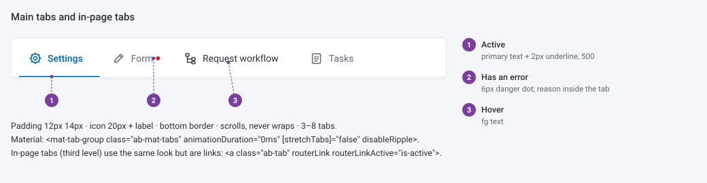

The top-level sections of a workspace (Overview, Design, Workflow…).

- Row: `0 12px` padding, 4px gap, bottom border, horizontal scroll if it overflows (never wraps).
- Tab: icon (20px) + label, `12px 14px` padding, `--ab-muted` text, 2px transparent bottom border.
- Hover: text `--ab-fg`. Active: text and 2px underline `--ab-primary`, weight 500.
- A tab whose content has a validation problem shows a 6px `--ab-danger` dot after its label (`.has-error`, or `.taberror` in the form builder). Give the user the reason inside the tab; the dot only says where to look.
- With Angular Material put `class="ab-mat-tabs"` on `<mat-tab-group>` and use `animationDuration="0ms"`, `[stretchTabs]="false"`, `disableRipple`. With plain markup use `div.ab-tabs[role=tablist] > button.ab-tab[role=tab][aria-selected]`.
- 3–8 tabs. If you need more, the workspace is doing too much; move secondary areas into the section rail of one tab.

### 3.5 Body — `.ab-body`

Grid of `260px` section rail + flexible pane (`--ab-rail-w`). See [Section rail](#5-section-rail).

### 3.6 Page frame and title

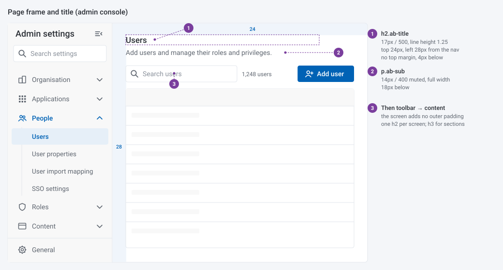

Every admin screen's header sits at the same place in the same type, whatever link opened it.

| Property | Value |
|---|---|
| Frame | `.admin-content` in the admin console, padding **24px top, 28px left and right, 32px bottom** (`--ab-space-6` / `--ab-space-7` / `--ab-space-8`) |
| Title position | Top of the title's line box 24px below the top of the content area, left edge 28px from the left nav |
| Title | `h2.ab-title`: Roboto (`--ab-font-ui`), **17px**, weight **500**, line height 1.25 (21px), `--ab-fg`, no top margin, 4px bottom margin, `text-wrap: balance` |
| Description | `p.ab-sub`: Roboto, **14px**, weight 400, line height 1.5, `--ab-muted`, full width, 18px bottom margin |
| Then | Toolbar (search, count, actions) → content |

**Rules**

- The frame owns the gutter. A screen adds **no outer padding or margin** and starts directly with its title. Bootstrap `.container`/`.container-fluid` wrappers, `.px-*` and `.col` at a screen's root have their side padding removed by the frame, and anything above the title loses its top margin.
- One `h2` page title per screen. Use `h3` and smaller for sections within the page (`h2`s inside a screen are restyled as page titles).
- Shells that hold sub-pages (Roles, Data) add no padding either; their screens follow the same rule.
- Detail panels, dialogs and previews keep their own title styles (the frame rules exclude `.ab-panel`, `[class*="modal"]` and `[class*="preview"]`).
- Implementation: `src/scss/design-system/_page-frame.scss`. Its resets exist for older screens and use `!important` to beat Bootstrap utilities such as `mt-*`; remove a reset once nothing needs it.

- **Subtitles run the full width of their section** (page, panel header, settings section). Don't cap them at a character width.

### 3.6.1 Pane — `.ab-pane`

- Inside the frame, a pane needs no padding of its own (`.ab-pane` keeps `24px 28px` only for use outside the admin console, e.g. the form builder's Properties tab).
- `.ab-pane--with-aside`: two columns, content + 340px aside (`--ab-aside-w`), 28px gap. Collapses to one column at ≤ 1100px.
- Starts with `h2.ab-title` and `p.ab-sub`. Then, in order: toolbar → content → inline action bar → notes.

### 3.7 Aside — `.ab-aside`

Supporting information that reacts to what is being edited: an API preview, a live preview, a help panel. Never required to complete the task. Heading is an `h3.ab-overline` with a 16px icon.

### 3.8 Action bar — `.ab-actionbar`

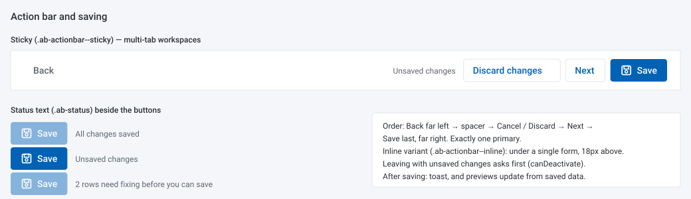

Where the user commits or abandons work.

- `--sticky`: pinned to the bottom of the viewport with top border, `12px 20px` padding. Use for multi-tab workspaces (the form builder).
- `--inline`: no border or padding, 18px top margin. Use under a single form in a pane.
- **Order:** navigation back on the far left (text button) → spacer → Cancel / Discard (stroked) → Next (stroked) → **primary action last, far right** (Save). Exactly one primary button.
- Status text (`.ab-status`, 12px muted) sits next to the buttons: "Unsaved changes", "All changes saved", "2 rows need fixing before you can save".

---

## 4. Left navigation

The admin console navigation. **One list** with search and up to **two levels**. Replaces the old Operations / Configurations split.

Component: `<app-side-nav>` (`src/app/_view/_ui-components/side-nav/`). Data: `SettingsService.adminNav`.

### 4.1 Anatomy

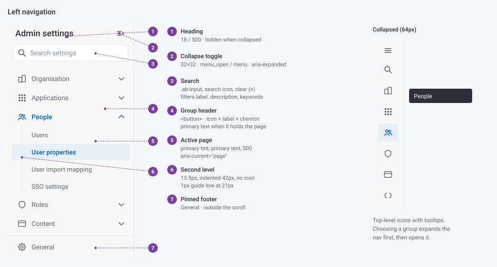

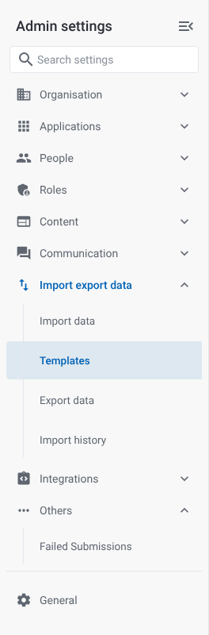

*Current page Data › Templates; Others is the last group; General pinned at the bottom.*

```
┌──────────────────────────────┐
│ Admin settings          [≡]  │  heading (18/500) + collapse toggle (icon button)
│ ┌──────────────────────────┐ │
│ │ 🔍 Search settings    ✕ │ │  search input (.ab-input) with icon and clear button
│ └──────────────────────────┘ │
│ 👥 People                 ⌄ │  group: icon + label + chevron (a <button>)
│ │  Users                     │  second level: label only, indented 42px,
│ │  Roles                     │  with a 1px guide line under the group icon
│ │▓ User properties ▓▓▓▓▓▓▓▓▓│  active page: primary tint + primary text, 500
│ ▦ Applications            ⌄ │  collapsed group
│ ▤ Content                 ⌄ │
│            (scrolls)         │
├──────────────────────────────┤
│ ⚙ General                    │  pinned link: footer, outside the scroll
└──────────────────────────────┘
```

| Part | Spec |
|---|---|
| Container | `--ab-surface-2` background, right border `--ab-line`, padding `16px 8px`, full height, sticky. Width `--ab-nav-w` (264px); collapsed `--ab-nav-w-collapsed` (64px). |
| Heading | `h2`, 18px / 500, single line with ellipsis. Hidden when collapsed. |
| Collapse toggle | 32×32 icon button, `menu_open` when expanded, `menu` when collapsed. Tooltip and `aria-label` "Collapse navigation" / "Expand navigation", `aria-expanded`. |
| Search | Full-width `.ab-input`, 34px left padding for the `search` icon, clear button (`close`, 18px) on the right when there is a query. Placeholder "Search settings". |
| Top-level item | Min-height 38px, padding `9px 12px`, 10px icon gap, `--ab-radius-sm`, `--ab-muted` text, 20px icon. |
| Group header | As a top-level item, plus a 20px `expand_more` chevron on the right that rotates 180° when open. It is a `<button>` with `aria-expanded` and `aria-controls`. |
| Second-level item | Min-height 34px, padding `7px 12px 7px 42px`, 13.5px text, **no icon**. A 1px `--ab-line` guide line runs down the left at 21px. |
| Badge | `.ab-badge` on the right ("New"). One word. |
| Gap between items | 2px. |
| Pinned footer | `ul.ab-nav__pinned` below the scrolling list, top border `--ab-line`, 8px top padding. Holds top-level links (`pinned: true`) that should always be in reach (General). One or two items at most. |

### 4.2 States

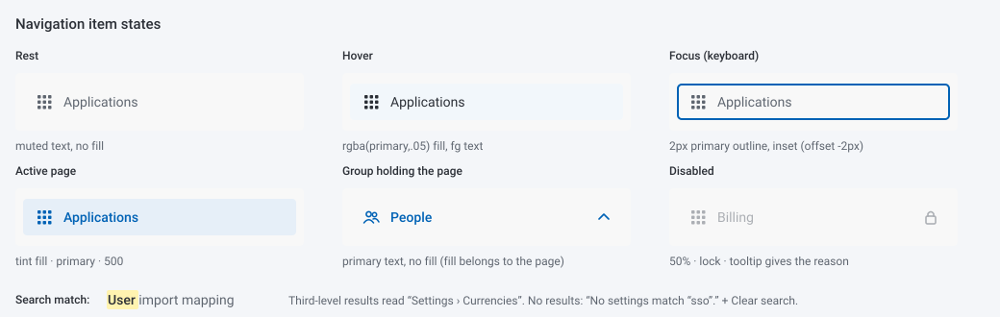

| State | Treatment |
|---|---|
| Rest | `--ab-muted` text, transparent background |
| Hover | `rgba(primary, .05)` background, `--ab-fg` text |
| Focus (keyboard) | 2px `--ab-primary` outline, inset (`outline-offset: -2px`) so it is not clipped by the scroll area |
| Active page | `--ab-primary-tint` background, `--ab-primary` text, weight 500, `aria-current="page"` |
| Group containing the active page | Text and icon `--ab-primary`, weight 500, **no fill** (the fill belongs to the page). When the nav is collapsed the group gets the fill instead, because the page itself is hidden. |
| Disabled | 50% opacity, `not-allowed` cursor, `lock` icon on the right, tooltip with the reason (for example "Your licence does not permit adding additional applications"). Still focusable so the tooltip is reachable; `aria-disabled="true"`. |
| Search match | Matching characters wrapped in `<mark class="ab-mark">` (soft yellow) |

### 4.3 Information architecture

Top level is a small number of **groups**; screens are the **second level**. Current groups, in order:

| Group | Icon | Items |
|---|---|---|
| Organisation | `domain` | Settings† · Billing |
| Applications | `apps` | Applications · Application categories · Entity builder · Evaluation matrix · Features |
| People | `group` | Users · User properties · User import mapping · SSO settings |
| Roles | `admin_panel_settings` | System roles · Custom roles (a screen promoted to a group, see below) |
| Content | `web` | Menu · Pages · Cards · Announcements · Site design |
| Communication | `forum` | Notifications · Email logs |
| Data | `import_export` | Import data · Templates · Export data · Import history (a screen promoted to a group) |
| Integrations | `integration_instructions` | Integrations · Xoxoday · Marketplace |
| Others | `more_horiz` | Failed submissions, plus any screen not yet placed in a group. Always the last group |
| *(pinned)* | `settings` | General, at the bottom of the nav |

† Has a third level shown as a [list with a detail panel](#69-feature-list-and-detail-panel): Settings → Company name · Company address · Date format · Number format · Application type (Plus Innovations only) · Currencies (not for asset management).

Old addresses redirect to the new ones (see [4.6](#46-addresses-routes)); for example `/admin/configurations/company-profile` → the Settings list, `/organisation-settings` → Settings › Application type, `/currency-settings` → Settings › Currencies.

Which items appear depends on the app type and licence (`SettingsService.initModulesEnabled`). A group with no enabled items is removed. A group left with one item is still shown as a group, so the nav keeps the same shape across tenants.

**Rules**

- **Two levels in the nav.** When a screen has sub-pages, pick one of three treatments, never two at once, and never a second menu down the left of a screen:
  1. **Promote the screen to a group** when its sub-pages are separate destinations admins go to directly (Roles → System roles, Custom roles; Data → Import data, Templates, Export data, Import history). The screen draws no tabs. Configure it in `ADMIN_NAV_GROUPS` with `screen` and `children`.
  2. **List with a detail panel** when the sub-pages are a set of small, separate settings (Settings → Company name, Date format…). See [6.9](#69-feature-list-and-detail-panel).
  3. **In-page tabs** when the sub-pages are views of one thing that admins switch between without leaving it. No admin screen uses this at the moment; see [4.8](#48-third-level-in-page-tabs).
  For 2 and 3, list the sub-pages in `ADMIN_NAV_TABS` so the nav search finds them.
- **5–9 groups.** Each group holds **2–7 items**. If a group grows past 7, split it.
- A top-level **link** (no children) is allowed for a destination used constantly by everyone. Pin it to the bottom (`ADMIN_NAV_PINNED`, as General is) rather than mixing it in with the groups.
- Group order is set by the product owner (currently Organisation, Applications, People, Roles first). Order items within a group by how often admins use them, not alphabetically.
- Labels are nouns, sentence case, 1–3 words, and match the screen's `h1`/`h2` exactly.
- Every item has a `description` (shown as a tooltip and used by search). Add `keywords` for synonyms and old names, so an admin searching "SAML" finds SSO settings.
- **Adding a screen:** add its `SettingItem` to `operationsList` or `configurationsList` in `settings.service.ts` (this keeps the route and module gating), then add its `routerLink` to the right group in `ADMIN_NAV_GROUPS`, and any synonyms to `ADMIN_NAV_KEYWORDS`. A screen not placed in a group is shown under **Others** at the end, which is a reminder to place it, not a home. If the screen has sub-pages, also add them to `ADMIN_NAV_TABS` (see 4.8).

### 4.4 Behaviour

- **Expand / collapse groups** independently; more than one group can be open. The group holding the current page opens itself on load and on navigation. Open groups are remembered per browser.
- **Search** filters as you type (no submit), case-insensitive, across item label, description and keywords, and across both levels.
  - Several words must all match ("user import" finds User import mapping).
  - If a group's own label matches, all its items are shown.
  - Third-level pages (in-page tabs and detail-panel items) are searched too and listed under their group as **Screen › Page** ("Settings › Currencies"), with the screen name muted. Choosing one opens that tab or panel directly. They never appear in the tree when not searching.
  - Every group with a hit is shown open while searching; your own open/closed choices come back when the search is cleared.
  - Matches are highlighted.
  - `Enter` opens the first result and clears the search. `Esc` clears the search. `↓` moves from the search box into the results.
  - No results: "No settings match “query”." with a **Clear search** text button.
  - The result count is announced to screen readers through a polite live region.
- **Collapsed mode** (64px): top-level icons only, each with a tooltip on the right. The search becomes a `search` icon button. Choosing a group or search **expands the nav first** (a group has nothing to show at 64px), then opens the group or focuses the search. Collapsed / expanded is remembered per browser.
- **Keyboard:** `Tab` moves through the nav as normal. Inside the list, `↑` / `↓` move between visible items, `Home` / `End` jump to the first / last, and `↑` from the first item returns to search. `Enter` / `Space` open a link or toggle a group.
- Choosing an item emits `navigate`, which the admin console uses to show its loading overlay.

### 4.5 API

```html
<app-side-nav
  heading="Admin settings"
  ariaLabel="Admin settings"
  searchPlaceholder="Search settings"
  storageKey="adminConsole.nav"
  [items]="adminNav"
  [(collapsed)]="sidebarCollapsed"
  (navigate)="showNavigationLoader()">
</app-side-nav>
```

| Input / output | Type | Notes |
|---|---|---|
| `items` | `SideNavNode[]` | Top level. A node with `children` is a group; otherwise it needs `routerLink`. |
| `heading` | `string` | Optional heading above the search. |
| `searchPlaceholder` | `string` | Also the search box's accessible name. |
| `collapsible` | `boolean` | Default `true`. |
| `collapsed` / `collapsedChange` | `boolean` | Two-way. The parent uses it to size its column. |
| `storageKey` | `string` | Prefix for remembered state (`<key>.expanded`, `<key>.collapsed`). Empty: remember nothing. |
| `ariaLabel` | `string` | Accessible name of the `<nav>`. |
| `navigate` | `EventEmitter<SideNavNode>` | Fires when a link is chosen. |

```ts
interface SideNavNode {
  id: string;              // stable; not derived from the label
  label: string;
  icon?: string;           // required on top-level nodes
  routerLink?: string;
  description?: string;    // tooltip + search
  keywords?: string[];     // search only
  exact?: boolean;         // active only on this exact URL
  children?: SideNavNode[]; // group: its screens. screen: its in-page tabs (search only)
  disabled?: boolean;
  disabledTooltip?: string;
  badge?: string;          // one word, e.g. 'New'
  pinned?: boolean;        // top level only: shown in the footer below the scrolling list
}
```

### 4.6 Addresses (routes)

There is no admin home page: `/` and `/admin` open the first item in the nav (Organisation › Settings). Admin addresses follow the nav: **`/admin/<group>/<screen>`**, lower case, hyphenated, nouns. A group's own address redirects to its first screen. Third-level pages add one more segment.

| Group | Addresses |
|---|---|
| Organisation | `organisation/settings` (areas: `organisation/settings/<area>`, e.g. `…/currencies`), `organisation/billing` |
| Applications | `applications/list`, `applications/categories`, `applications/entity-builder`, `applications/evaluation-matrix`, `applications/features` |
| People | `people/users`, `people/user-properties`, `people/user-import-mapping`, `people/sso` |
| Roles | `roles/system`, `roles/custom` |
| Content | `content/menu`, `content/pages`, `content/cards`, `content/announcements`, `content/site-design` (areas: `content/site-design/<area>`) |
| Communication | `communication/notifications`, `communication/email-logs` |
| Data | `data/import`, `data/templates`, `data/export`, `data/history`, `data/history/:fileId` |
| Integrations | `integrations/connections`, `integrations/xoxoday`, `integrations/marketplace` |
| Others | `others/failed-submissions` |
| Pinned | `general` |

**Rules**

- When a screen moves in the nav, its address moves with it, and the old address gets a redirect at the bottom of the admin routes in `app-routing.module.ts`. Never delete an old address: bookmarks and links in emails still use it. (Every pre-redesign `operations/…` and `configurations/…` address redirects.)
- **Every redirect uses `pathMatch: "full"`.** A prefix redirect on a parent segment (as `configurations` once was) captures every address under it and silently breaks those links.
- Write addresses in one place. Nav links live in `settings.service.ts`; screens that link to another screen use a constant (as `ImportRoutes` does) rather than a string literal.
- Guards check the address **after** redirects, so the asset management allow list (`AuthGuard`) lists new addresses only.
- Screens that are not in the nav (Import data upload, Reports, Application settings, SMS) keep their old addresses until they are given a place.

### 4.7 Don't

- Don't split the nav into tabs or separate lists (Operations / Configurations). One list.
- Don't draw a third level in the nav, and don't put icons on second-level items.
- Don't put actions ("Add user") in the nav. The nav is for places.
- Don't hide an item the admin is not licensed for if they would reasonably look for it; show it disabled with the reason.
- Don't style the nav per screen. Change the component and this section.

### 4.8 Third level: in-page tabs

When a screen's sub-pages are views of one thing that admins switch between without leaving it, the nav keeps one entry for the screen and the sub-pages appear as a **tab bar across the top of the screen**. (For the other two treatments, promoted group and list with a detail panel, see the rules in 4.3.) This keeps the nav short and stable, works when the nav is collapsed, and gives each sub-page its own URL so links and the browser back button work.

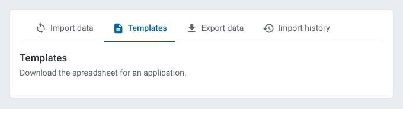

```html
<nav class="ab-tabs" aria-label="Example">
  <a class="ab-tab" routerLink="/admin/example/overview" routerLinkActive="is-active"
     [routerLinkActiveOptions]="{ exact: true }" ariaCurrentWhenActive="page">
    <mat-icon aria-hidden="true">dashboard</mat-icon>Overview
  </a>
  <a class="ab-tab" routerLink="/admin/example/history" routerLinkActive="is-active"
     ariaCurrentWhenActive="page">
    <mat-icon aria-hidden="true">history</mat-icon>History
  </a>
</nav>
<router-outlet></router-outlet>
```

- Same look as the [main tabs](#34-main-tabs--ab-tabs--ab-mat-tabs): 20px icon + label, muted, primary text and 2px underline when active.
- They are links (`<a routerLink>`), not buttons, because each tab is a page. The screen's own URL is the first tab and is matched exactly.
- The nav entry for the screen stays active on every tab (its URL is a prefix of theirs).
- 2–6 tabs, sentence case nouns. The tooltip carries the tab's description.
- List the tabs in `ADMIN_NAV_TABS` (`settings.service.ts`) so nav search finds them. Prefer drawing the tab bar from `SettingsService.navTabsFor(link)`, which also applies `enableKey` and `excludeAppTypes`, so the bar and the search can never disagree. 
- A tab the tenant can't use is left out, not shown disabled.
- No fourth level. If a tab needs sub-sections, use a [section rail](#5-section-rail) inside it.

**Every third level is searchable, whatever its treatment.** The same `ADMIN_NAV_TABS` list feeds tabs *and* list + detail panel screens: Organisation › Settings (its six areas), Content › Site design (Logo and favicon, Homepage banners, Website branding, Homepage widgets, Custom CSS) and Integrations › Connections (Microsoft Teams app). The screen draws its list from `navTabsFor(link)` and opens the panel from the URL (`<screen>/<area>`, componentless `:area` child routes), so a search result lands on the open panel. Per-item conditions are fields on the entry: `enableKey`, `excludeAppTypes`, `superAdminOnly`. A list screen whose items are data (Features, Marketplace) is not listed; its own page has a search box.

---

## 5. Section rail

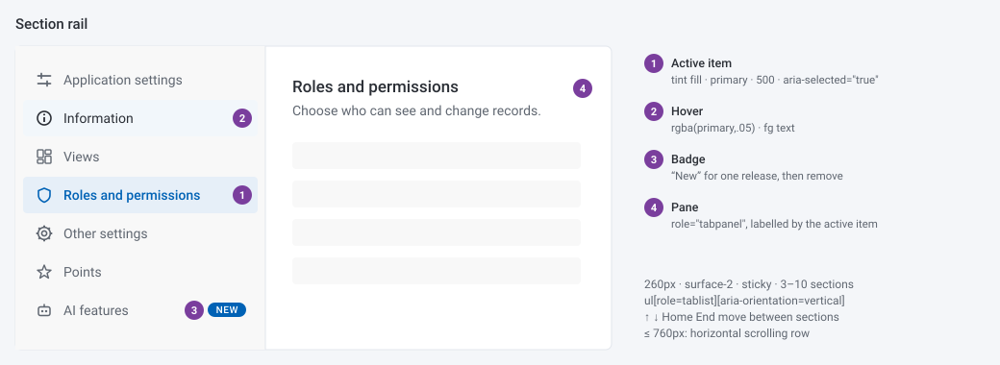

The vertical list of sections **inside** a workspace tab (the form builder's Settings tab). Same visual language as the left nav, single level.

**Form builder › Settings** is one tab and one rail: **Application settings** first (name, category, type), then the property sections (Information, Views, Roles and permissions, Other settings, Points, AI features, Integrations). It is the first tab and opens on Application settings for a new or edited application; creating from a template skips Application settings, as before. Save errors about the name, category or type reopen it. There is no separate Properties tab. In code: `app-properties` takes `[leadSection]` and projects `[props-lead]` as rail position 0.

| Part | Spec |
|---|---|
| Container `.ab-rail` | 260px wide (`--ab-rail-w`, wide enough for "Roles and Permissions" plus its icon), `--ab-surface-2`, right border, padding `16px 8px`, sticky, scrolls on its own |
| List `.ab-rail__list` | Column, 2px gap |
| Item `.ab-rail__item` | `<button>` (or `<a>` if it changes the URL), icon + label, padding `9px 12px`, 10px gap, `--ab-radius-sm`, `--ab-muted` |
| Hover | `rgba(primary, .05)` background, `--ab-fg` text |
| Active `.is-active` / `[aria-selected=true]` | `--ab-primary-tint` background, `--ab-primary` text, 500 |
| Badge | `.ab-badge` pushed right ("New" for a recently added section; remove after one release) |

- Markup is a vertical tab list: `ul[role=tablist][aria-orientation=vertical] > li[role=none] > button[role=tab]`, with `aria-selected`, roving `tabindex` (0 on the active item, −1 on the others) and `↑` / `↓` / `Home` / `End` moving between sections. The pane is `role="tabpanel"` with `aria-labelledby` pointing at the active item.
- Drive the active state from component state (`[class.is-active]="selectedTabIndex === i"`), never by adding and removing classes on DOM elements.
- At ≤ 760px the rail becomes a horizontal scrolling row above the pane.
- 3–10 sections. Labels are sentence case nouns.

---

## 6. Components

All classes live in `src/scss/design-system/_components.scss`. Naming: `.ab-block`, `.ab-block__element`, `.ab-block--modifier`, state as `.is-*` (`.is-active`, `.is-selected`, `.is-invalid`, `.is-on`, `.is-disabled`).

### 6.1 Headings and text

| Class | Element | Spec |
|---|---|---|
| `.ab-title` | `h2` | 17px / 500, `--ab-fg`, 4px bottom margin. First thing in a pane. |
| `.ab-sub` | `p` | 14px / 400, `--ab-muted`, line height 1.5, full width, 18px bottom margin. Explains what the section does and what happens when it is changed. |
| `.ab-subtitle` | `h3` | 14px / 500. A group inside a section. |
| `.ab-overline` | `h3`/`div` | 11px / 500, uppercase, `.06em`, `--ab-muted`, optional 16px icon. Aside headings and small section labels. |
| `.ab-count` | `span` | 12px muted. "3 properties". |
| `.ab-mono` | `code`/`span` | Roboto Mono 12.5px. |

Every pane has a title and a subtitle. If you can't write the subtitle, the section probably needs rethinking.

### 6.2 Buttons — `.ab-btn`

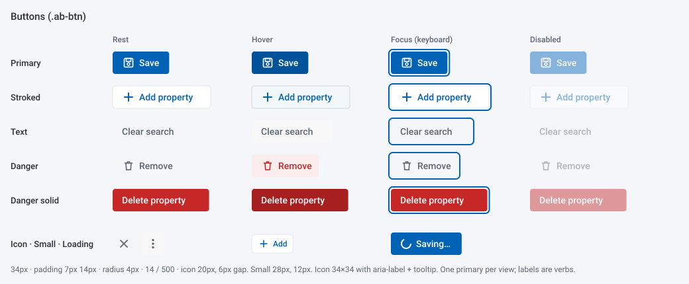

Base: inline-flex, 6px gap, `7px 14px` padding, min-height 34px, `--ab-radius-sm`, 14px / 500, 20px icon. Always a `<button type="button">` (or `<a>` for navigation).

| Variant | Class | Look | Use |
|---|---|---|---|
| Primary | `.ab-btn--primary` | `--ab-primary` fill, white text; hover `--ab-primary-hover` | The one main action in a view: Save, Create, Confirm |
| Stroked | `.ab-btn--stroked` | White, `--ab-line` border, primary text; hover `--ab-line-strong` border and faint tint | Secondary actions: Add property, Preview, Cancel, Discard changes, Next |
| Text | `.ab-btn--text` | No border, muted text, tight padding | Tertiary and in-line actions: Back, Clear search |
| Danger | `.ab-btn--danger` | Muted icon or text; hover red text on red tint | Row-level remove (`delete_outline`) |
| Danger solid | `.ab-btn--danger-solid` | Red fill, white text | The confirm button in a destructive dialog only |
| Icon | `.ab-btn--icon` | 34×34, muted, hover faint grey | Close, overflow menus. **Must** have `aria-label` and a tooltip |
| Small | `.ab-btn--sm` | `4px 10px`, min-height 28px, 12px | Dense toolbars and inline actions |

**States:** hover as above; focus-visible 2px primary ring offset 1px; disabled (`:disabled`, `[aria-disabled=true]`, `.is-disabled`) 45% opacity and `not-allowed`; loading: swap the icon for an 18px `mat-spinner`, change the label to the present participle ("Saving…"), set `[disabled]` and `aria-busy`.

**One theme for every button.** Inside the admin console (`.admin-content`), the form builder (`.ab-theme`) and their dialogs (`.cdk-overlay-container`), `_buttons-bridge.scss` maps every older button class to these looks, so the same action looks the same everywhere and never takes the tenant colour: `.primary-button`, `.button-blue`, `.form__button-blue`, `.btn-primary`, Material raised / flat primary or accent → **Primary**; `.secondary-button`, `.cancel-button`, `.btn-secondary`, `.btn-outline-*`, Material stroked → **Stroked**; `.btn-danger`, Material warn → **Danger solid**. New markup still uses `.ab-btn` directly.

**Rules**

- One primary button per view (per dialog, per action bar).
- Labels are verbs in sentence case: "Save properties", "Add property", "Discard changes". Not "OK", not "Submit", not "Click here".
- Leading icon for actions (`add`, `save`); trailing icon only for direction (`arrow_forward`).
- When a button is disabled, say why next to it (see [Editing and saving](#71-editing-and-saving)).
- Don't build buttons from `<div>` or `<span>` with `(click)`; they are not keyboard accessible. (The old form builder footer did this; it has been replaced.)

### 6.3 Form fields

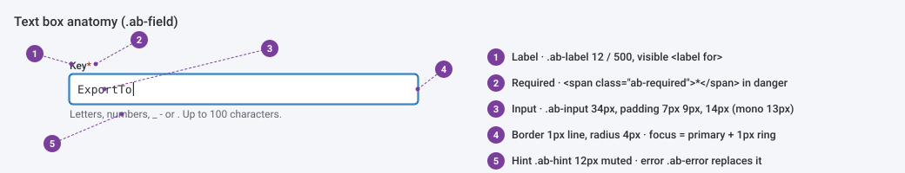

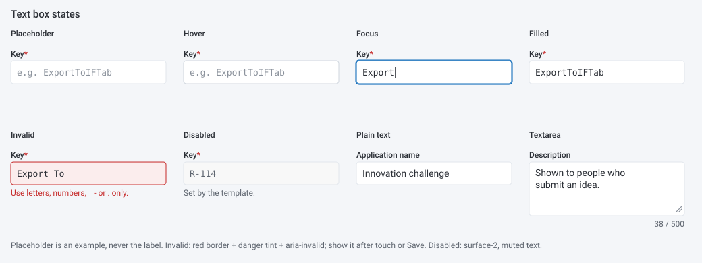

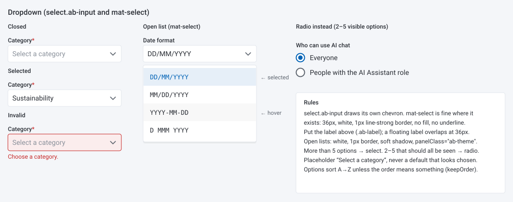

| Class | Spec |
|---|---|
| `.ab-field` | Column wrapper, 4px gap, 16px bottom margin |
| `.ab-label` | 12px / 500, `--ab-fg`. Required marker `<span class="ab-required">*</span>` in `--ab-danger` |
| `.ab-input` | `input`, `select`, `textarea`. 100% width, `7px 9px` padding, min-height 34px, white, 1px `--ab-line`, `--ab-radius-sm`, 14px |
| `.ab-input--mono` | Roboto Mono 13px. Keys, IDs, codes, expressions |
| `.ab-hint` | 12px muted, 4px top margin. Format and limits |
| `.ab-error` | 12px `--ab-danger`, 4px top margin. Replaces the hint when invalid |

**States:** placeholder `--ab-placeholder`; hover border `--ab-line-strong`; focus border `--ab-primary` + 1px primary ring (no glow); invalid (`.is-invalid` or `aria-invalid="true"`) red border and `--ab-danger-tint` background; disabled `--ab-surface-2` background, muted text.

- `select.ab-input` draws its own chevron; `textarea.ab-input` is at least 80px tall and resizes vertically.
- Every input has a visible `<label>` (or, in tables, an `aria-label` that names the row: "Key", "Value").
- Link the hint or error with `aria-describedby`.
- Placeholders show an example ("e.g. ExportToIFTab"), never the label or an instruction.
- Show character limits as a hint ("Up to 100 characters") or a counter (`12/40`) when the limit is likely to be reached.
- **Angular Material fields** (`mat-form-field`, `mat-select`) are fine where they already exist. Everywhere (not only inside `.ab-theme`) they are 36px high with 14px text and look like `.ab-input`: white, 1px `--ab-line-strong` border, 4px corners, darker border on hover, primary border + 1px ring when focused, no grey fill and no underline (`_material.scss`, and the select rules in `material-reset.scss`). Open lists are white with a 1px border and a soft shadow. A filled field with its label inside can overlap at 36px; put the label above the field (`.ab-label`). For new simple fields prefer the native `.ab-input`.

### 6.4 Selection controls

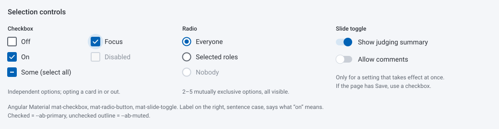

Use Angular Material `mat-checkbox`, `mat-radio-button`, `mat-slide-toggle`, `mat-slider`. Inside `.ab-theme` they use `--ab-primary` for the checked state and `--ab-muted` for the unchecked outline.

- **Checkbox** for independent options and for opting a card in or out (see [Cards](#67-cards--ab-card)).
- **Radio** for 2–5 mutually exclusive options that should all be visible. More than 5: a select.
- **Slide toggle** for a setting that takes effect immediately (no Save). If the page has a Save button, use a checkbox instead.
- Labels are on the right of the control, in sentence case, and say what "on" means ("Show judging summary").

### 6.5 Tables — `.ab-table`

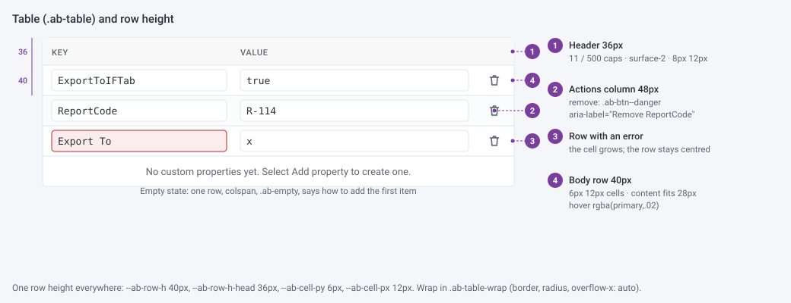

```html
<div class="ab-table-wrap">
  <table class="ab-table">
    <thead><tr><th>Key</th><th>Value</th><th class="ab-table__actions"><span class="ab-sr-only">Remove</span></th></tr></thead>
    <tbody>…</tbody>
  </table>
</div>
```

| Part | Spec |
|---|---|
| Wrapper `.ab-table-wrap` | 1px border, `--ab-radius-sm`, `overflow-x: auto` |
| Table | Full width, collapsed borders, `min-width: 560px` (scrolls inside the wrapper below that) |
| `th` | 11px / 500 uppercase `.06em`, muted, `8px 12px`, row height 36px (`--ab-row-h-head`), `--ab-surface-2` background, bottom border, no wrap |
| `td` | `6px 12px` (`--ab-cell-py` / `--ab-cell-px`), row height 40px (`--ab-row-h`), bottom border (none on last row), `vertical-align: middle` |
| Row hover | `rgba(primary, .02)` |
| Actions column `.ab-table__actions` | 48px, right aligned, header text visually hidden |

#### Row height

One row height everywhere in the console: lists, data tables, the form builder's Roles and permissions, Points and Assign tasks grids, and any new table.

| Row | Height | Cell padding | Token |
|---|---|---|---|
| Header | 36px | `8px 12px` | `--ab-row-h-head` |
| Body, one line of text | 40px | `6px 12px` | `--ab-row-h`, `--ab-cell-py`, `--ab-cell-px` |
| Body, name with a sub-line (person, icon tile) | grows to fit, no extra padding | `6px 12px` | — |

- Content in a row must fit 28px: checkboxes use a 32px touch area (`--mat-checkbox-state-layer-size: 32px`), icon buttons 28px, inputs (Points) 28px, chips 26px or less.
- The rule lives once in `_components.scss` (`:is(.ab-table, .abdt__table, .fbp-rp__table, .ti-table, .at__table)`); a new table either uses `.ab-table` or is added to that list. Don't set row padding in a component.
- Cells are vertically centred. A cell that shows an error under an input grows; the rest of the row stays centred.

#### Row actions

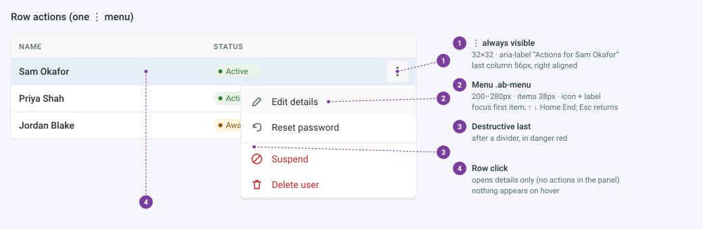

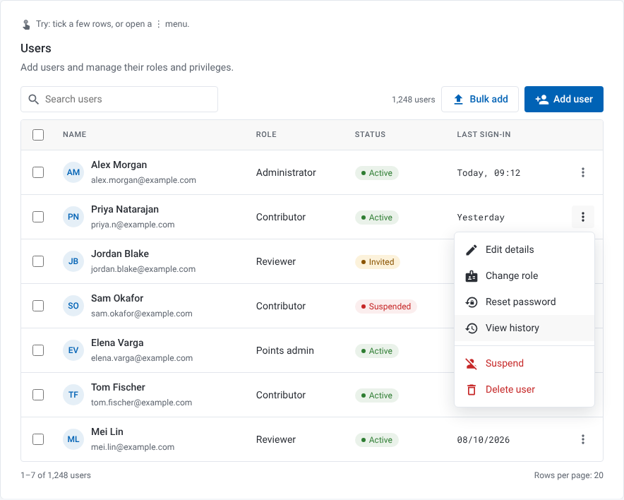

Every row's actions sit behind **one ⋮ button that is always visible** in the last column. **Actions never appear on hover.**

| Part | Spec |
|---|---|
| ⋮ button | 32×32, `more_vert`, `--ab-muted`; hover/focus `--ab-surface-2` background. Accessible name "Actions" (or "Actions for {name}"). Last column 56px wide, right aligned |
| Menu `.ab-menu` | Opens under the button (above it if there is no room), right edges aligned; 200–280px wide, `--ab-surface`, 1px border, 6px radius, soft shadow, 6px vertical padding |
| Item `.ab-menu__item` | 38px high, 20px muted icon + label in sentence case ("Reset password"). Hover/focus `--ab-surface-2` |
| Order | Most used first (View, Edit…), state changes next (Enable / Disable, shown as one item whose label matches the row's state), destructive last after a divider (`.ab-menu__divider`), in `--ab-danger` |
| Keyboard | Opening focuses the first item; `↑`/`↓`/`Home`/`End` move; `Enter` runs; `Esc` closes and returns focus to ⋮; `Tab` closes |
| Closing | Choosing an item, clicking outside, `Esc`, scrolling or resizing |

**Clicking the row** (anywhere except ⋮ and checkboxes) **opens the detail panel with details only**: the record's values as an `.ab-dl`, no action buttons. Actions are only in the ⋮ menu. A table with its own details screen shows that; otherwise `app-item-management` builds the panel from the table's columns.

**Bulk actions**: where a table offers them, a checkbox column first; selecting rows replaces the toolbar with a tinted bar: "N selected", the bulk actions as text buttons, and a clear (×) button.

In `app-item-management` and every [data table](#651-data-table--app-ab-data-table) this is built in: the existing `disableEdit` / `disableToggle` / `disableDelete` / `disablePassword` / `disableView` inputs, `moreCustomActions` and `passwordActionHiddenWhen` decide which items each row's menu contains.

- **Editable rows**: inputs fill the cell; the remove button is `.ab-btn--danger` with `delete_outline` and `aria-label="Remove <key>"`.
- **Empty state**: one row, `colspan` across all columns, `.ab-empty` text that says how to add the first item ("No custom properties yet. Select **Add property** to create one.").
- **Toolbar** above the table (`.ab-toolbar`): count on the left (`.ab-count`), actions on the right.
- Lists of records (search, sort, pages) use the [data table component](#651-data-table--app-ab-data-table). The `angular2-smart-table` package has been removed.

### 6.5.1 Data table — `app-ab-data-table`

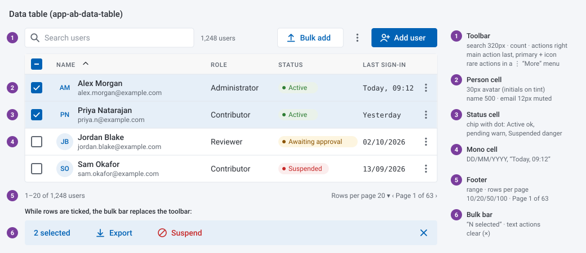

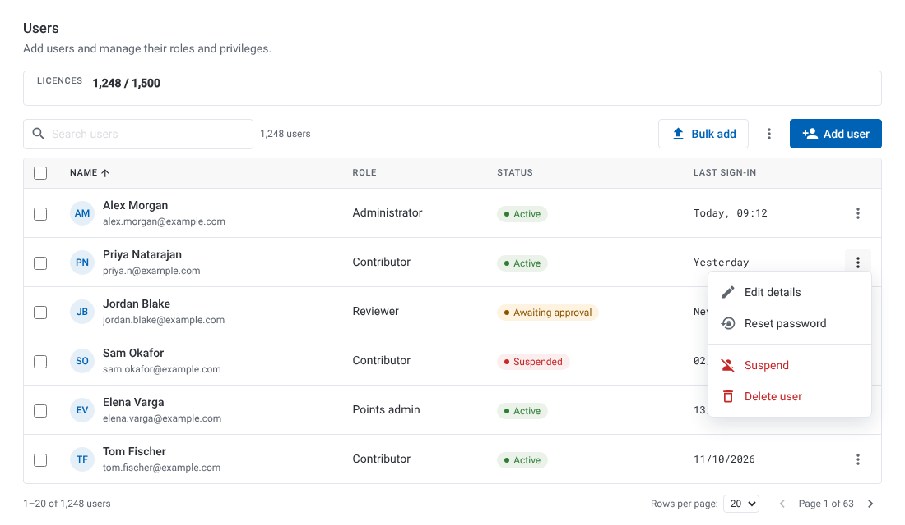

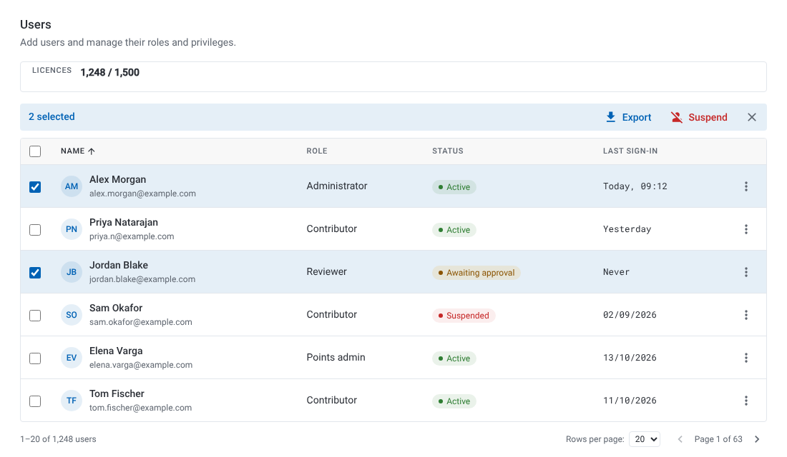

The one component for lists of records (`src/app/_view/_ui-components/ab-data-table/`, standalone). It takes the existing column configs and data sources, so a screen moves over by swapping the tag. Data sources live beside it in `ab-data-source.ts`: `AbLocalDataSource` (rows in memory) and `AbServerDataSource` (paging, filtering and sorting by an endpoint: `page`/`perPage` or `_page`/`_limit`, `<field>_like`, `_sort`/`_order`, rows at `dataKey`, total at `totalKey` or the `x-total-count` header). `IBEXTNG2ServerDataSource` extends `AbServerDataSource` with the busy callback and the local sort fallback. `app-item-management` uses it for all its tables; Applications, Entity builder, Import data history and Form management use it directly. People › Users is the reference.

| Part | Spec |
|---|---|
| Toolbar | Search box (320px, `search` icon inside, placeholder naming what it searches: "Search by name, email, role or status"), then the count ("1,248 users", `.ab-count`), then the screen's actions on the right: secondary actions stroked, the main action last and primary with an icon ("Add user", `person_add`). Rarely used actions go in a ⋮ "More" menu beside them (Users: Bulk add template, Download all users, Import users from AD, Bulk delete from file) |
| Bulk bar | Replaces the toolbar while rows are ticked: `--ab-primary-tint` bar, "N selected" (500, primary), bulk actions as text buttons (primary; destructive in red), clear (×). Only on tables with bulk actions (`selectable`) |
| Header | As `.ab-table`. Sortable columns are buttons; the arrow shows on hover and stays on the sorted column (asc → desc → off), `aria-sort` set. Checkbox column 44px with select-all for the page (indeterminate when some) |
| Rows | `td` 10px 12px, vertically centred. Hover `rgba(primary,.02)`; ticked or open in a panel: `--ab-primary-tint`. Clickable rows are focusable; `Enter` opens |
| Person cell (`abType: 'person'`) | 30px round avatar (photo, or initials on `--ab-primary-tint` in primary, 12px / 500), name 500, secondary line (email) 12px muted |
| Status cell | Chip with a 6px dot, 12px, 10px radius: Active `--ok`, Awaiting approval / pending `--warn`, Suspended / Inactive / Failed `--danger`, others neutral. Any column titled "Status" gets it; `abTone(row, label)` overrides the guess |
| Mono cell (`abType: 'mono'`) | Dates, IDs, codes in Roboto Mono 12.5px. Dates DD/MM/YYYY; recent sign-ins "Today, 09:12", "Yesterday"; never "Never" |
| ⋮ menu | [Row actions](#row-actions): `rowActions(row)` returns the items; destructive ones are moved last after a divider automatically |
| Footer | "1–20 of 1,248 users" on the left; "Rows per page" (10 / 20 / 50 / 100, default 20) and ‹ Page 1 of 63 › on the right, 12px muted |
| Loading | 2px indeterminate bar along the top of the table, rows dimmed; first load says "Loading users…" |
| Empty | One row across all columns, `.ab-empty`: "No users yet", or "No users match “term”" while searching |

```html
<app-ab-data-table [source]="source" [columns]="columns" itemName="user" [selectable]="true"
  [rowActions]="rowActionsFor" searchPlaceholder="Search users" [searchFilter]="userSearch"
  (rowClick)="openDetails($event)" (rowAction)="onAction($event)" (selectionChange)="selected = $event">
  <button ab-table-actions class="ab-btn ab-btn--primary"><mat-icon>person_add</mat-icon>Add user</button>
  <button ab-table-bulk class="ab-btn ab-btn--text"><mat-icon>download</mat-icon>Export</button>
</app-ab-data-table>
```

**Columns** keep the angular2-smart-table shape: `title`, `hide`, `valuePrepareFunction(value, cell)`, `type: 'custom'` with `renderComponent` + `componentInitFunction(instance, cell)` (the instance also gets `rowData` and `value`), `type: 'html'`, `isFilterable`, `isSortable`, `sortDirection`, `width`, `class`. Design-system extras: `abType` (`person` / `status` / `mono`), `abPerson(row)`, `abTone(row, label)`.

**Sort**: header click sends the sort as `_sort`/`_order` and `sortColumn`/`sortOrder`. If the page that comes back is not in that order, the endpoint doesn't sort, and `IBEXTNG2ServerDataSource` sorts that column itself from then on (whole list loaded once, then filtered, sorted and paged locally; dropped on refresh). Objects sort by their name (Category → `ContentType.Name`).

**Search** filters one column by default (the first filterable one; placeholder "Search by {column}"). The server ANDs `<field>_like` filters and can't filter on every field, so a table that must search several fields gives `searchFilter(term)` and, where needed, a data source that does the matching. People › Users uses `UsersDataSource` (`people/users-data-source.ts`): with no search it pages on the server; with a search it loads the whole list once (parallel pages), matches **first name, last name, email, role or status** (status as shown: "suspended" finds Inactive users), each word matching any of them ("alex admin"), then sorts and pages locally. The copy is dropped when the search is cleared or the table refreshes after an add, edit, suspend or delete.

**Rules**

- Row actions only in ⋮; nothing on hover; row click opens details only. People › Users' details panel is the model (below): a tinted identity band with a 64px avatar (photo, or initials in white on primary), name 22px / 500, email, status chip and role chips; **Details** and **Activity** tabs; on a `--ab-bg` body, white cards (8px radius) titled with a primary icon and 15px / 500 text: **Account** (username, email, names, status, prefix) and **Profile** (user properties with a value, "4 of 14 set"; empty ones behind "Show N empty fields", shown in italic placeholder "Not set"). Values are full-strength text (#1d2127) at 14px with 12px / 500 labels, so the panel stays crisp.

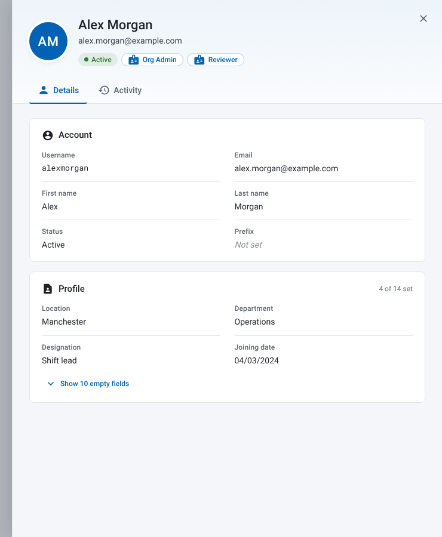
- Checkbox column only where bulk actions exist. Selection is per page and clears when the page, search or sort changes.
- Counts and ranges use British number format (1,248) and the item noun (`itemName`, `itemNamePlural`).
- Each action label says what it does to what: "Edit details", "Delete user", "Edit in form builder", "Export package".

### 6.6 Chips and badges

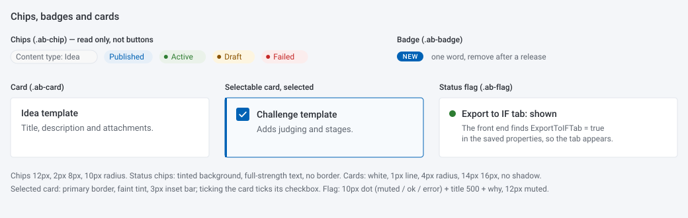

| Class | Spec | Use |
|---|---|---|
| `.ab-chip` | 12px, `2px 8px`, pill radius, `--ab-surface-2` with `--ab-line` border, muted text | Read-only context: "Content type: RPG Application" |
| `.ab-chip--primary` / `--ok` / `--danger` / `--warn` | Tinted background, full-strength text, no border | Status: "Published", "Draft", "Failed" |
| `.ab-badge` | 10px / 500 uppercase, primary fill, white, 8px radius | "New" on a nav or rail item. One word. Remove after a release. |

Chips are not buttons. If it can be clicked or removed, it is a different component (use Material chips and document it here first).

### 6.7 Cards — `.ab-card`

- White, 1px `--ab-line`, `--ab-radius-sm`, padding `14px 16px`. No shadow.
- `.ab-card--selectable`: pointer cursor, hover border `--ab-line-strong`; `.is-selected` adds a primary border, a very faint primary tint and a 3px primary inset bar on the left. Selecting a card should also tick its checkbox if it has one; the card and the checkbox must not disagree.
- Card title: `.ab-subtitle`; description: 12–14px muted.

### 6.8 Settings section — `.ab-section`

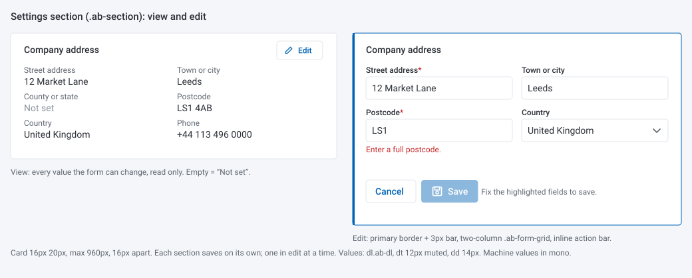

One group of saved settings (Company name, Company address, Date format, Number format, Application type), usually inside a Settings detail panel. When embedded in a panel the section heading is visually hidden (`[embedded]="true"`) because the panel title already says it, and the Edit button stays on the right (`.ab-section__edit`). Shows the current values read-only, with an **Edit** button; Edit swaps the body for a form with **Cancel** and **Save**. Each section saves on its own.

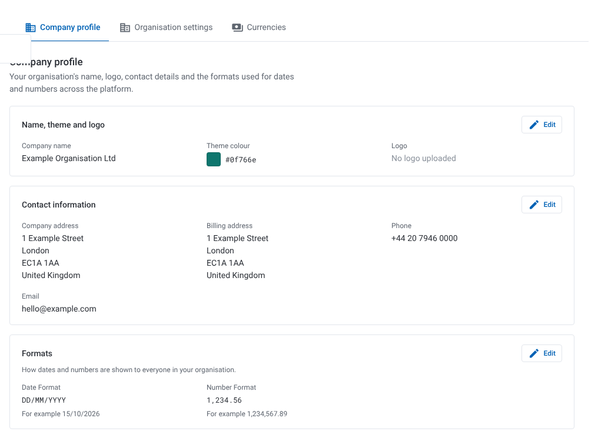

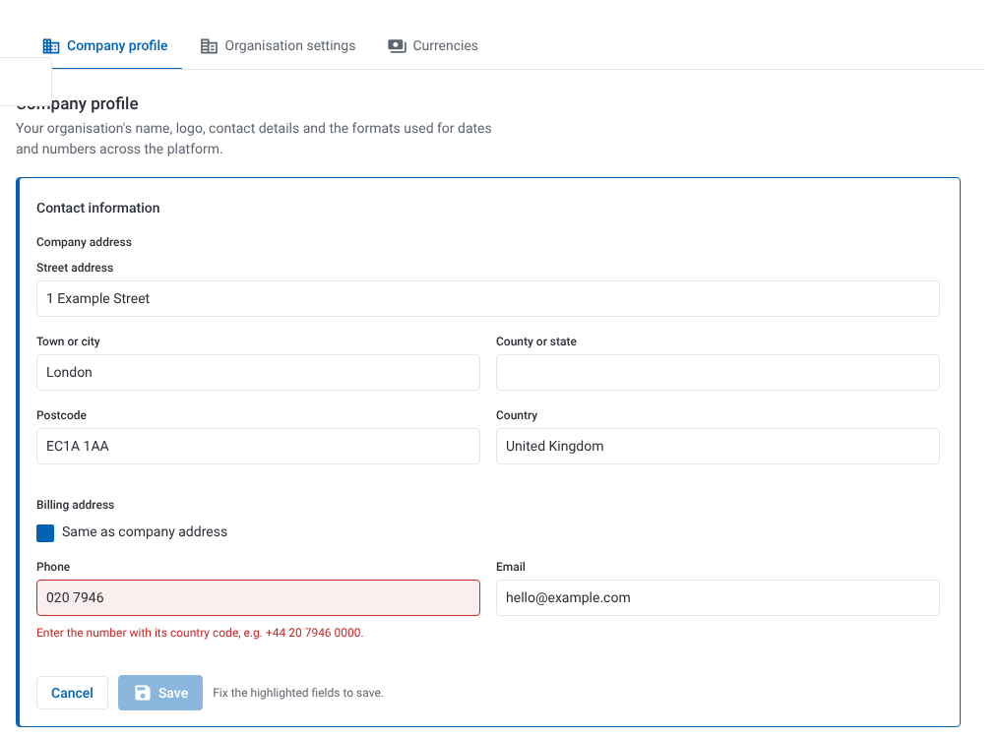

| Part | Spec |
|---|---|
| Card `.ab-section` | `--ab-surface`, 1px border, `--ab-radius-sm`, padding `16px 20px`, 16px bottom margin, `max-width: 960px` |
| Editing `.is-editing` | Primary border and 3px primary inset bar on the left (same as a selected card) |
| Header `.ab-section__head` | `h3.ab-subtitle` on the left; Edit button (`.ab-btn--stroked.ab-btn--sm`, `edit` icon) on the right, hidden while editing. **Embedded in a panel** (heading visually hidden): the header has no row of its own; it floats right so Edit sits on the same line as the first label / value |
| Description `.ab-section__desc` | Optional, 12px muted, under the header, full width |
| Values `dl.ab-dl` | Auto-fill grid of `minmax(220px, 1fr)` columns, gaps 16px × 24px. Each pair is `<div><dt>Label</dt><dd>Value</dd></div>`: `dt` 12px muted, `dd` 14px `--ab-fg`. Empty values show `.ab-dl__empty` ("Not set") in `--ab-placeholder` |
| Form layout `.ab-form-grid` | Two equal columns, 16px gap; `.ab-field--full` and fieldsets span both; one column at ≤ 760px |
| Field groups `fieldset.ab-fieldset` | No border; `legend` 12px / 500 as the group label (e.g. "Company address") |
| Actions | `.ab-actionbar--inline`: Cancel (stroked), Save (primary, `save` icon), then `.ab-status` when Save is unavailable ("Fix the highlighted fields to save.") or to show "Unsaved changes" |

**Rules**

- Only one section is in edit mode at a time where possible; never auto-save a section that has a Save button. (Exception, flagged in its hint: the theme colour swatch saves when picked.)
- View mode shows every value the form can change, so admins don't have to open Edit to read a setting.
- Machine values (formats, domains, colour codes) are in mono.
- Addresses: labelled fields (Street address, Town or city, County or state, Postcode, Country) with `autocomplete` tokens, not placeholders as labels.
- A choice between a few options with explanations (App type) uses selectable cards with a radio inside (`.ab-card--selectable`, `.is-selected`).

### 6.9 Feature list and detail panel

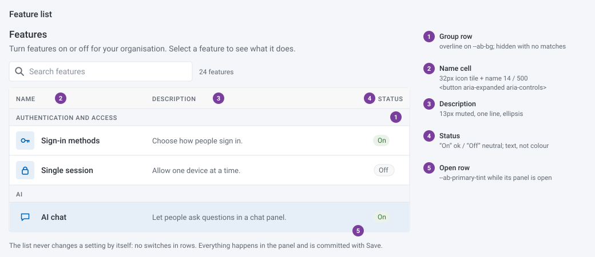

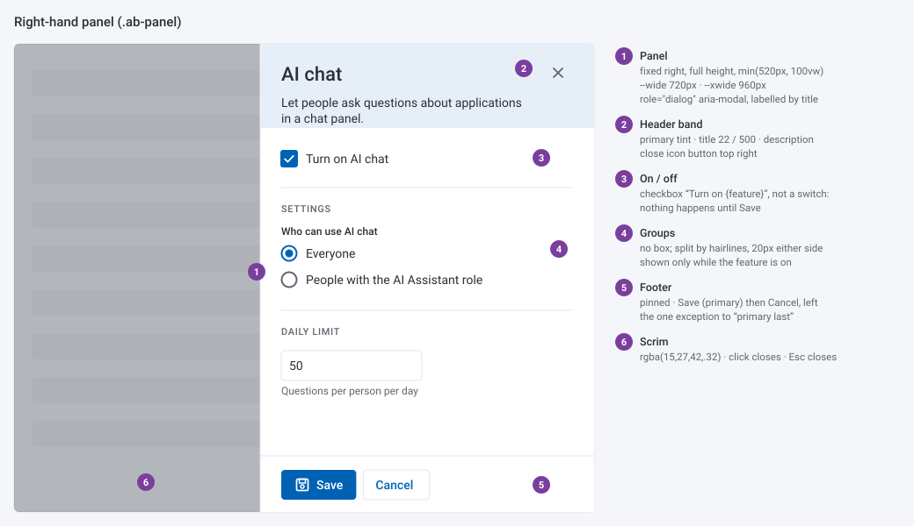

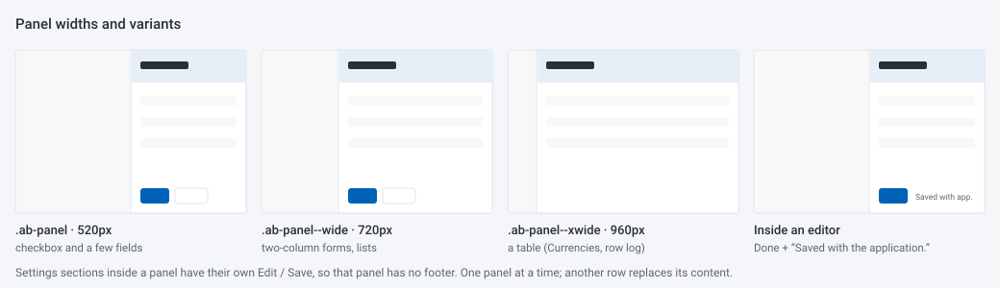

For screens that are a set of separate things to switch on, install or configure: Features, Site design, Marketplace, Integrations, and Organisation › Settings (Company name, Company address, Date format, Number format, Application type, Currencies). Use it for any future "services", "integrations" or "add-ins" list too. A scannable list of everything available, and a panel from the right with one feature's explanation, its on/off switch and its settings. The list stays visible behind the panel so admins keep their place.

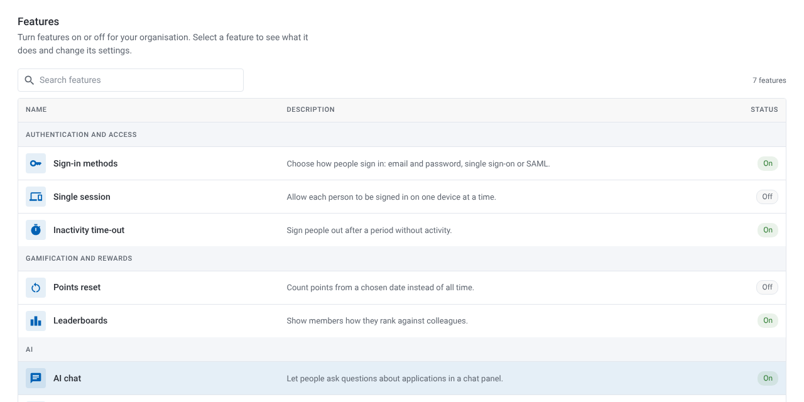

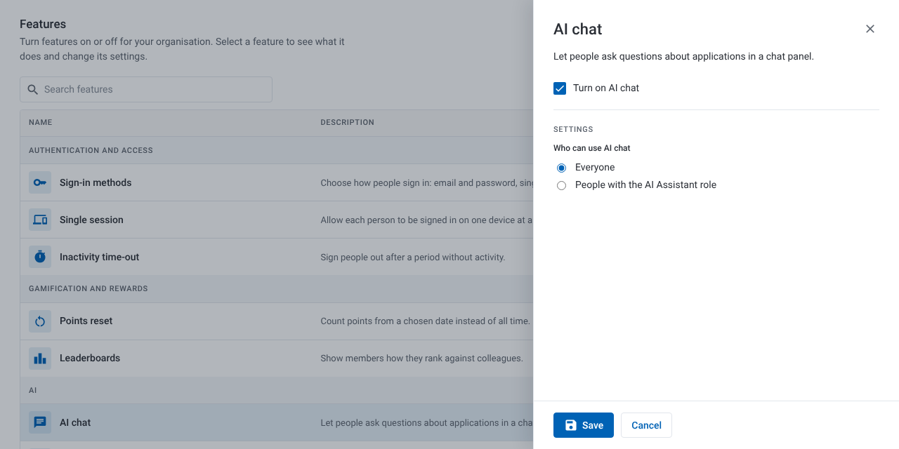

**List**

| Part | Spec |
|---|---|
| Header | `h2.ab-title` + `.ab-sub`, then a toolbar with a search field (leading `search` icon, filters as you type) and a count |
| Table | `.ab-table` with `table-layout: fixed`. Columns: **Name** (34%), **Description**, **Status** (96px, right aligned) |
| Group rows | One `<tbody>` per category with a full-width `th` overline row on `--ab-bg` ("Authentication and access", "AI"…). Groups with no matches are hidden |
| Name cell | 32px icon tile (`--ab-primary-tint` background, primary icon, `--ab-radius-sm`) + feature name 14px / 500. The name is a `<button>` with `aria-expanded` and `aria-controls` pointing at the panel; the whole row is also clickable |
| Description | 13px muted, one line with ellipsis (the panel shows it in full). Hidden at ≤ 760px |
| Status | `.ab-chip` "On" (`--ok`) or "Off" (neutral). Text, not colour alone |
| Selected row | The row whose panel is open gets `--ab-primary-tint` |
| Empty | "No features match “query”." or "No features are available for your organisation." |

The list never changes a setting by itself: no switches in rows. Everything happens in the panel, so every change is explained first and committed with Save.

**Detail panel**

| Part | Spec |
|---|---|
| Container | Fixed to the right edge, full height, `min(520px, 100vw)` wide, `--ab-surface`, left border and a soft shadow. Slides in 24px with a fade (off with reduced motion). `role="dialog"`, `aria-modal="true"`, `aria-labelledby` the title |
| Scrim | `rgba(15,27,42,.32)` over the page; clicking it closes the panel. Panel and scrim sit just below the CDK overlay layer (z 990/991) so dialogs opened from the panel (Send a test email, confirmations) appear on top |
| Header | Title 22px / 500 (the feature name), close icon button top right |
| Description | Full description, 14px `--ab-fg`, 24px below. Optional "Learn more about …" link under it when there is documentation |
| On/off | A checkbox labelled **"Turn on {feature name}"**, not a switch, because nothing happens until Save |
| Read only | When the admin can't change it, an `.ab-note--info` with a `lock` icon says who can ("Only a Points Admin can change this"); the checkbox and fields are disabled and Save stays disabled |
| Settings | Shown only while the checkbox is ticked, under a divider with an `.ab-overline` "Settings" heading, using the normal [form fields](#63-form-fields) |
| Footer | Pinned to the bottom with a top border: **Save** (primary) then **Cancel** (stroked), left aligned. In a narrow panel the primary action comes first so it sits under the content being edited; this is the one exception to "primary last". A panel whose content is [settings sections](#68-settings-section--ab-section) (each with its own Edit / Save) has **no footer**; the close button is enough |
| Width | `.ab-panel` 520px for a checkbox and a few fields; `.ab-panel--wide` 720px for forms with two columns or a list (Company name, Company address, Application type); `.ab-panel--xwide` 960px for a table (Currencies). Always `min(…, 100vw)` |

**Settings: list items without a status**

Settings uses the same list without the Status column, one row per area, and each area's panel holds the existing component with `[embedded]="true"`, which hides its own page title (the panel shows it) and keeps section headings for screen readers only. The open area is in the URL (`/admin/organisation/settings/<area>`) using componentless child routes, so the list does not re-render when a panel opens, and links, the nav search and the back button all work.

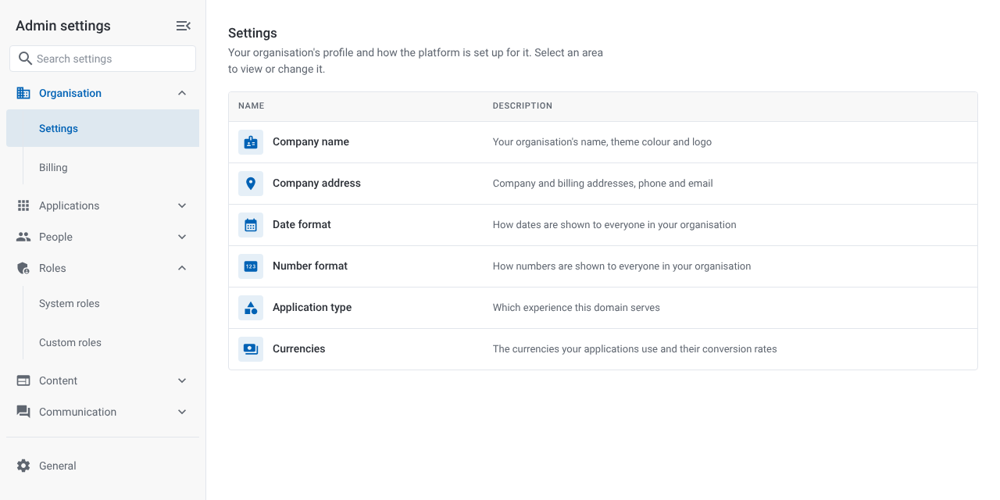

**Choosing one option from a list** (Application type): use the same row look inside the panel, with a radio first: radio · icon tile · name · description · "Current" chip on the saved value. The selected row is tinted. Not a grid of cards.

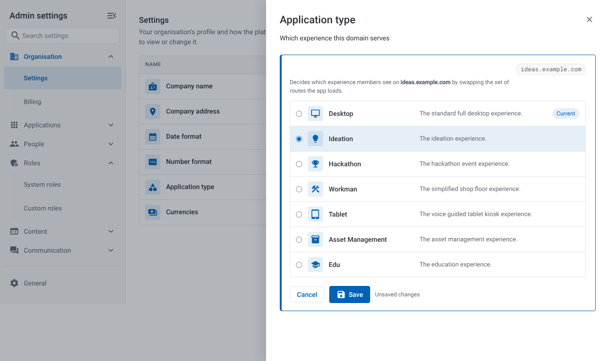

**Behaviour**

- Opening a feature loads its saved state into a draft; ticking or unticking the checkbox and editing settings change only the draft.
- **Save** is disabled until there is something to save: the on/off state changed, or the feature has settings and is on.
- Save closes the panel, updates the row's status and shows a toast ("AI chat saved"). Turning off something with consequences (Point reset) asks for confirmation first.
- **Cancel**, the close button, the scrim and `Esc` all close without saving. Focus moves to the panel title on open and back to the row's name button on close.
- One panel at a time; selecting another row replaces the panel's content.

**Every right-hand panel looks the same** (`.ab-panel`, `_components.scss`): a tinted (blue) header band with the title and, under it, the description (`.ab-panel__heading` > `.ab-panel__title` + `.ab-panel__desc`); a white body; content groups (`.ab-panel__card`, optional `.ab-panel__card-title` with a primary icon) with no box of their own, split by a hairline with 20px either side; actions in the footer on white. Inside a group, settings sections drop their own frame and `.ab-dl` becomes the two-column list with hairlines used in user details. Add / edit panels (`app-item-management`, Microsoft Teams, Slack, Teams app download) follow it too; a host with several groups of fields brings its own cards (`[editInCards]="true"`, as Edit user does: Account, System roles, Profile).

**Inside a larger editor** (form builder › Settings: Information, Views, Other settings, AI features), the panel edits the application being built, which is saved with the editor's own Save. There the panel applies changes as they are made and its footer is **Done** (primary) with "Saved with the application." beside it; Cancel and a draft are not used. Settings that need room (a view's columns and preview, the Info tab's columns) use `.ab-panel--wide`. Items the application type can't use show an "Unavailable" chip and a locked note in the panel. Integrations rows open their own set-up panel and show **Connected** / **Not set up**.

### 6.10 Notes — `.ab-note`

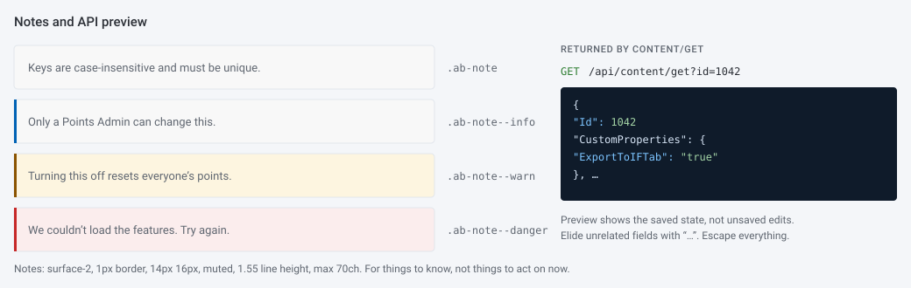

Explanatory or policy text below the main content ("Rules in this prototype").

- `--ab-surface-2`, 1px border, `--ab-radius-sm`, padding `14px 16px`, muted text at 1.55 line height, `max-width: 70ch`, 22px top margin. `<b>` and `<code>` inside use `--ab-fg`.
- Variants add a 3px left bar: `--info` (primary), `--warn` (warn colour and tint), `--danger` (danger colour and tint).
- A note is for things the user should know, not something they must act on now. For that, use inline validation or a dialog.

### 6.11 Code and API preview

| Class | Spec |
|---|---|
| `.ab-endpoint` | Mono 12px. `.ab-endpoint__method` in `--ab-ok`, 500, 6px right margin. `GET /api/content/get?id=1042` |
| `.ab-code` (`pre`) | `--ab-code-bg`, `--ab-code-fg`, mono 12px, line height 1.6, padding 14px, `--ab-radius-sm`, scrolls horizontally, `white-space: pre`. Keys `<span class="k">`, strings `<span class="s">` |

- Previews reflect the **saved** state, not unsaved edits, so they show what other systems really see. Say so in the overline ("Returned by content/get").
- Elide unrelated fields with `…`.
- Escape everything you interpolate into a preview.

### 6.12 Status flag — `.ab-flag`

A row explaining the effect of the current settings ("Export to IF tab: shown").

- 1px border, `--ab-radius-sm`, padding `12px 14px`, 10px gap.
- `.ab-flag__dot` 10px circle: muted by default, `--ab-ok` with `.is-on`, `--ab-danger` with `.is-error`.
- `.ab-flag__title` 500; `.ab-flag__desc` 12px muted, explains **why** ("The front end finds ExportToIFTab = true in the saved properties, so the tab appears.").

### 6.13 Toast — `.ab-toast`

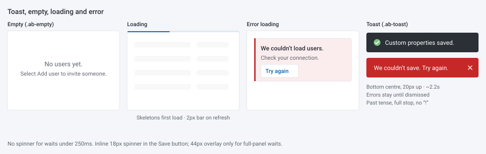

Confirmation that something finished.

- Fixed, centred, 20px above the bottom (plus safe area), `--ab-fg` background with `--ab-surface` text, `10px 16px`, `--ab-radius-sm`, `check_circle` icon (18px).
- Short past-tense sentence: "Custom properties saved". Disappears after about 2.2 seconds; never the only place an error is reported.
- In Angular use the existing snackbar/toastr service, configured to this look, rather than hand-rolling `.ab-toast` per screen. Errors use the danger colour and stay until dismissed.

### 6.14 Empty, loading and error states

- **Empty**: `.ab-empty` (centred muted text, 28px padding). Say what would be here and how to add it.
- **Loading**: skeletons (`ngx-skeleton-loader`) shaped like the content for first load; a 44px `mat-spinner` overlay only for full-panel waits (the admin console overlay); an inline 18px spinner in the button for save. Don't show a spinner for under 250ms.
- **Error loading**: a `.ab-note--danger` in the pane with what failed and a **Try again** stroked button.

### 6.15 Dialogs — modal confirmation

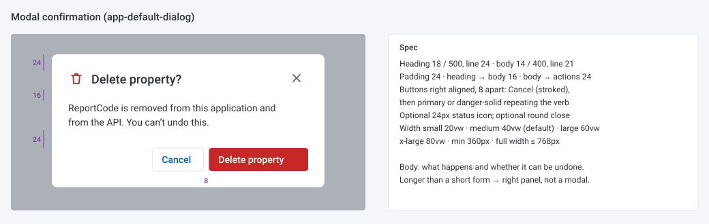

Every confirmation and small form in a modal uses the shared `app-default-dialog` (`DefaultDialogService`), which implements this pattern. Dialogs and select panels get `.ab-theme` by default (`MAT_DIALOG_DEFAULT_OPTIONS`, `MAT_SELECT_CONFIG` in `app.module.ts`).

| Modal attribute | Value |
|---|---|
| Heading | Roboto, 18px / 500, line height 24px, `--ab-fg` |
| Body | Roboto, 14px / 400, line height 21px |
| Outer padding | 24px, all sides (one white box, 8px corners; no header band, no footer rule) |
| Heading → body | 16px |
| Body → action row | 24px |
| Between buttons | 8px |
| Actions | Right aligned: **Cancel** (stroked), then the primary action (primary) or a destructive action (danger-solid) |
| Heading wording | Sentence case, action-based: "Discard changes?", "Delete property?" |
| Close | Optional round icon button top right (`ab-btn--icon`), same as Cancel |
| Status icon | Optional 24px icon before the heading or message: info (primary), warning (warn), delete (danger) |

- Body says what will happen and whether it can be undone.
- The action button repeats the verb ("Discard", "Delete property"), never "OK" / "Yes".
- Width: `small` 20vw, `medium` 40vw (default), `large` 60vw, `x-large` 80vw; full width at ≤ 768px. Minimum 360px.
- A dialog that edits several fields uses the normal [form fields](#63-form-fields) in the body; anything longer than a short form belongs in a [right panel](#69-feature-list-and-detail-panel), not a modal.

### 6.16 Stats — `.ab-stats` / `.ab-stat`

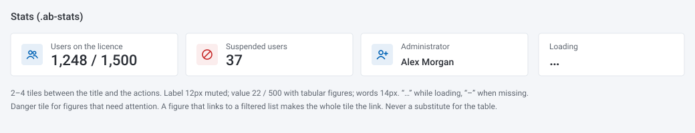

A row of summary figures at the top of a list screen, between the title and the actions. Read only; never a substitute for the table. Used on People › Users (users on the licence, suspended users, administrator), which took these figures over from the old home page.

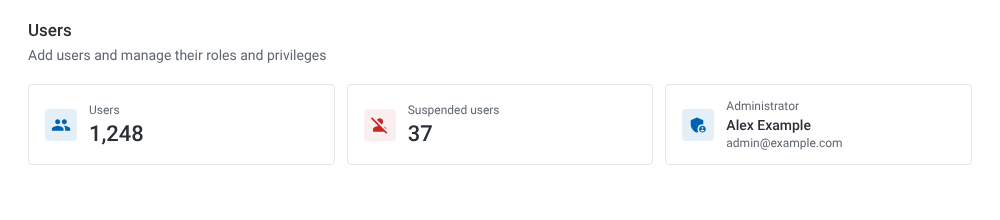

| Part | Spec |
|---|---|
| Row `ul.ab-stats` | Grid `repeat(auto-fit, minmax(180px, 1fr))`, 12px gap, `12px 0 16px` margin. `aria-label` naming the summary; `aria-busy` while loading |
| Tile `li.ab-stat` | `--ab-surface`, 1px border, `--ab-radius-sm`, padding `12px 16px`; [icon tile](#69-feature-list-and-detail-panel) then label and value |
| Label `.ab-stat__label` | 12px muted |
| Value `.ab-stat__value` | 22px / 500, tabular figures. `--text` modifier for words (a name): 14px, wraps |
| Variant `.ab-stat--danger` | Red icon tile, for figures that need attention (suspended users) |

**Rules**

- 2–4 tiles. Show "…" while loading and "–" when a value is missing, never a blank tile.
- Figures use thousands separators. Labels are sentence case nouns ("Suspended users").
- If a figure is a link to a filtered list, make the whole tile a link and say so in its label.
- On an `app-item-management` screen, put the stats in the `[item-header-extra]` slot so they sit between the title and the actions.

---

### 6.17 Accordions

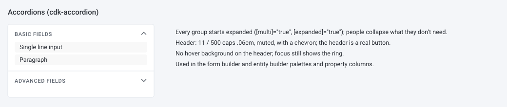

Collapsible groups in the form builder and entity builder palettes and property columns (`cdk-accordion`).

- **Open by default:** every group starts expanded (`[multi]="true"`, `[expanded]="true"`); people collapse what they don't need.
- Header: 11px / 500 uppercase `.06em`, muted, with an expand / collapse chevron; the header is a real button.
- **No hover background** on the header (a global rule in `_components.scss` clears it); focus still shows the focus ring.

## 7. Patterns

### 7.1 Editing and saving

- Changes are held locally until **Save**. Show `.ab-status` beside the buttons:
  - "All changes saved" (nothing to save, Save disabled),
  - "Unsaved changes" (Save enabled),
  - "N rows need fixing before you can save" (Save disabled, problems highlighted).
- **Discard changes** (stroked) restores the last saved state.
- After saving, show a toast and update any preview from the saved data.
- Leaving with unsaved changes asks for confirmation (route `canDeactivate` guard).

### 7.2 Validation

- Validate as the user types, but only show an error once a field has been touched or Save has been attempted.
- The error appears directly under the field (`.ab-error`) and the field gets `.is-invalid` / `aria-invalid="true"`.
- Messages say what to do, not what went wrong: "Enter a key.", "Use letters, numbers, _ - or . only.", "This key is already used above.", "Keys can be up to 100 characters."
- Uniqueness checks are case-insensitive unless the backend says otherwise.
- A tab with an error shows the red dot on its tab ([3.4](#34-main-tabs--ab-tabs--ab-mat-tabs)).

### 7.3 Destructive actions

- Removing a row in an unsaved list needs no confirmation: it can be undone with Discard changes.
- Deleting something already saved, or anything that cannot be undone, needs a dialog ([6.15](#615-dialogs--modal-confirmation)).

### 7.4 Search and filter

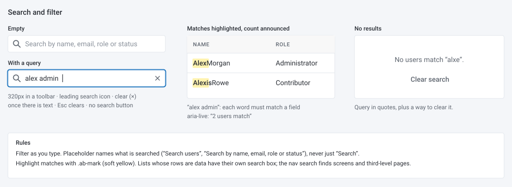

- Filter as you type; no search button.
- Search field: `.ab-input` with a leading `search` icon and a clear button once there is text. `Esc` clears.
- Highlight matches with `.ab-mark`. Announce the result count to screen readers.
- No results: say so with the query in quotes and offer a way to clear it.

---

## 8. Content and copy

- **British English**: colour, organisation, licence (noun), customise, cancelled.
- **Sentence case** for everything: titles, tabs, buttons, nav items, column headers (the overline style uppercases them visually; write them in sentence case in the source).
- **Dates** DD/MM/YYYY. Times 24-hour. Numbers with thousands separators (1,000).
- **Plain verbs** for actions: Select (not "Click"), Add, Remove, Save, Discard.
- **Second person, present tense**: "Add key/value pairs to this application."
- **Subtitles explain consequences**: what the setting changes and where.
- **Avoid jargon** in labels; put the technical name in mono where it helps admins connect it to the system (`content/get`, `ExportToIFTab`).
- **Errors** follow "what to do" + "the constraint" ([7.2](#72-validation)).
- **Messages set in code** (toasts, dialog titles and buttons in `.ts` files) follow the same rules as the markup:

| Kind | Rule | Example |
|---|---|---|
| Dialog title | Sentence case, the action or question, no full stop | "Delete banner?", "Change entity", "Weightage required" |
| Dialog buttons | The verb, never "OK" / "Yes" | "Delete banner", "Change type" |
| Success toast | Short past tense, full stop, no "successfully", no "!" | "Banner deleted.", "Teams app package downloaded." |
| Error toast | What happened, then what to do; no "Please" | "We couldn't load the form. Try again.", "Fill in all required fields." |
| Validation toast | The fix | "Choose a ZIP file.", "Choose a JPG, PNG, GIF or WEBP image." |

  When a spec asserts a message, change the spec with the message.
- Don't put real people's names, emails or other personal data in examples, placeholders or screenshots. Use clearly fictional data.

---

## 9. Accessibility

Target: **WCAG 2.2 AA**.

- **Contrast**: body text ≥ 4.5:1 (`--ab-fg` 13.4:1, `--ab-muted` 5.8:1 on white); UI component boundaries ≥ 3:1 where the boundary is the only cue (focus ring and active states use `--ab-primary`, 6.2:1).
- **Focus**: visible 2px `--ab-primary` outline on `:focus-visible`, offset 1px (inset in scroll areas). Never `outline: none` without a replacement.
- **Semantics**: `<nav>` with `aria-label` for the left nav and the section rail; `<header>` and `<footer>` for the app bar and action bar; real `<button>`s and `<a>`s; headings in order (one `h1` in the app bar, `h2` per pane).
- **State**: `aria-current="page"` on the active nav link; `aria-expanded` and `aria-controls` on group headers and the collapse toggle; `aria-selected` on tabs and rail items; `aria-invalid` on invalid fields; `aria-busy` on a saving button; `aria-disabled` on disabled-with-reason items.
- **Names**: every icon-only button has `aria-label` and a tooltip; decorative icons `aria-hidden="true"`; table inputs have `aria-label`s; the remove button names its row.
- **Live regions**: search result counts and save confirmations are announced (`aria-live="polite"`).
- **Keyboard**: everything reachable with `Tab`; lists and rails support arrow keys ([4.4](#44-behaviour), [5](#5-section-rail)); `Esc` clears search and closes overlays.
- **Motion**: respect `prefers-reduced-motion`.
- **Zoom**: usable at 200% zoom and 320px width without page-level horizontal scroll.
- `.ab-sr-only` visually hides text that must still be read out.

---

## 10. Implementing in Angular

### 10.1 Files

| Path | What |
|---|---|
| `src/scss/design-system/_tokens.scss` | All `--ab-*` tokens |
| `src/scss/design-system/_components.scss` | `.ab-*` classes |
| `src/scss/design-system/_material.scss` | Angular Material token alignment inside `.ab-theme` |
| `src/scss/design-system/_legacy-bridge.scss` | Restyles legacy classes inside `.ab-theme` (temporary) |
| `src/scss/design-system/_index.scss` | Forwards the above; loaded once from `src/scss/styles.scss` |
| `src/app/_view/_ui-components/side-nav/` | `<app-side-nav>` standalone component and `SideNavNode` model |
| `src/app/_services/settings.service.ts` | `adminNav`, `ADMIN_NAV_GROUPS`, `ADMIN_NAV_KEYWORDS` |
| `src/app/_view/admin-console/` | Hosts the left nav |
| `src/app/_view/form-builder/form-builder.component.*` | Workspace shell: app bar, main tabs, action bar |
| `src/app/_view/form-builder/properties/properties.component.*` | Section rail |
| `docs/design-system/diagrams/` | Annotated diagrams (`ds-*.svg`) for each pattern, and `gen_ds_svgs.py`, which draws them from the tokens |

### 10.2 Adopting the system in a screen

1. Add `ab-theme` to the screen's outermost element.
2. Build new markup from the `.ab-*` classes. Component stylesheets should only contain layout specific to that screen (grid areas, heights), using tokens.
3. Use `var(--ab-…)` for every colour, size and space. No hex values, no `--primaryColor` in new code.
4. Prefer real elements (`button`, `a`, `nav`, `header`, `footer`, `table`) and the ARIA in [section 9](#9-accessibility).
5. Remove the screen's now-unused legacy styles in the same PR.

### 10.3 Rules for stylesheets

- Never `@use 'config/_button'` (or other legacy global rule files) in a component stylesheet: Angular scopes them to that template, where `button[_ngcontent]` outranks `.ab-btn` and blanks design-system buttons (this hid Users' Add user button). The global styles already include them.
- New shared styles go in `_components.scss` with a section in this document. Don't create a second copy of a component in a screen stylesheet.
- No `!important`, except to beat an existing `!important` you can't remove yet; comment why.
- Avoid `::ng-deep`. Where you must reach into a Material component, scope it under `:host` and the component's own class, and prefer setting Material's `--mat-*` tokens over overriding its internal classes.
- No inline `style="…"` for colours or spacing.
- Keep selectors shallow: one class, plus a state class or element where needed.

### 10.4 Legacy bridge

`_legacy-bridge.scss` restyles older classes (Bootstrap `.form-control` / `.btn-primary`, `.primary-button`, `.secondary-button`, `.dark-button`, `h2.title`, `.sub-title`, `.section-title`, `.bg-grey`, border utilities) **only inside `.ab-theme`**, so a screen can take on the new look before its markup is rewritten. It uses `.ab-theme.ab-theme` to outrank component-scoped styles without `!important`.

- Do **not** use legacy classes in new markup, and do not add rules to the bridge for new work.
- When the last use of a legacy class inside `.ab-theme` screens is gone, delete its bridge rule.

### 10.5 Angular Material

- Inside `.ab-theme`, Material components take admin colours from `_material.scss` (it sets `--mat-*` tokens at the component level, because the prebuilt theme sets them there).
- Overlays (select panels, menus, dialogs, tooltips) render outside `.ab-theme` in the CDK overlay container. Pass `panelClass="ab-theme"` (select, menu) or add it to the dialog's `panelClass` when the overlay needs the admin look.

### 10.6 Tenant theme colour

The rest of the app still uses the tenant's `--primaryColor`. `.ab-theme` overrides it only for its descendants. Don't change `--primaryColor` globally, and don't use `--ab-primary` in end-user (non-admin) screens.

---

## 11. Pull request checklist

Copy into the PR description for any admin UI change.

- [ ] Screen root has `.ab-theme`; new markup uses `.ab-*` classes.
- [ ] No hard-coded colours, font sizes or spacing; tokens only.
- [ ] One primary button per view, on the right of the action bar.
- [ ] Every pane has an `h2.ab-title` and an `.ab-sub` that explains consequences.
- [ ] Text is British English, sentence case; dates DD/MM/YYYY.
- [ ] Lists of records use `app-ab-data-table`, not a hand-built or third-party table.
- [ ] Table rows: one always-visible ⋮ menu for actions; row click opens details only; nothing appears on hover.
- [ ] Icons on coloured backgrounds inherit the text colour (no dark icons on primary buttons).
- [ ] All interactive elements are `<button>`/`<a>`; icon-only buttons have `aria-label` + tooltip.
- [ ] Keyboard: reachable, visible focus, arrow keys in lists and rails, `Esc` clears search.
- [ ] Validation messages under the field, say what to do, and Save explains why it is disabled.
- [ ] Empty, loading and error states designed.
- [ ] Works at 1100px and 760px widths with no page-level horizontal scroll.
- [ ] On/off capabilities use the feature list and detail panel (no switches that save on click).
- [ ] New sub-page, list area or panel: listed in `ADMIN_NAV_TABS` with its own address, so nav search finds it.
- [ ] New nav item: added to a group in `ADMIN_NAV_GROUPS`, with `description` and keywords, at an address that follows the nav (4.6).
- [ ] Moved screen: old address redirects with `pathMatch: "full"`.
- [ ] No real personal data in examples, fixtures or screenshots.
- [ ] This document updated if a token, component or rule changed (and changelog entry added). If the change alters a diagram, redraw it with `gen_ds_svgs.py`.

---

## 12. Adoption status and known gaps

| Area | Status |
|---|---|
| Admin left nav | **Done.** Single list, search (including third-level tabs), two levels, collapse, keyboard. |
| Roles | **Done.** Promoted to a nav group (System roles, Custom roles); no tabs. |
| Page frame and titles | **Done.** All admin screens: title at 24px / 28px, 17px Roboto 500; description 14px. |
| Site design | **Done.** List + detail panel: Logo and favicon, Homepage banners, Website branding, Homepage widgets, Custom CSS. |
| Marketplace | **Done.** List + detail panel with Installed status and Install / Go to Applications. |
| Integrations | **Done.** List; Microsoft Teams app opens its panel (restyled to match `.ab-panel`), Xoxoday opens its own page (› marker). |
| Tables | **Done.** Every table uses `app-ab-data-table` (6.5.1): all `app-item-management` tables (Users, Categories, Evaluation matrix, Cards, Announcements, Pages, Notifications, Custom roles, Failed submissions, SSO, Currencies, Email logs), Applications, Entity builder, Import data history, Form management. The `angular2-smart-table` package is removed; its data sources were replaced by `ab-data-source.ts`. |
| People › User properties | **Done.** Same table style as Users: search, count, Unsaved changes, Save changes, Add property; name with type icon, settings as chips, parent, associated roles, ⋮ (Edit, Add below, Edit list options, Delete); drag to reorder (off while searching); row click opens the property panel. |
| People › Users | **Done.** Matches the reference: stats, toolbar (search, count, Bulk add, More, Add user), checkbox column and bulk bar (Export, Suspend), Name / Role / Status / Last sign-in, ⋮ (Edit details, Reset password, Suspend / Reactivate, Delete user). Last sign-in shows once the list API returns `LastLoggedin`. |
| Home page | **Dropped.** `/` and `/admin` open the first nav item. Its licence figures moved to People › Users as stats; the asset management sidebar lost its Home item, and the other sidebar's Home became "Admin settings". |
| Data | **Done.** (Was "Import export data".) Promoted to a nav group (Import data, Templates, Export data, Import history); no tabs or in-page menu. Import data shows its four steps one per row, full width. Import history opens a file's row log in a right panel (`.ab-panel--xwide`, "Open page" for the shareable `data/history/:fileId` address). |
| Failed submissions | Moved to the Others group, the last group above General. |
| Features | **Done.** Rebuilt as the feature list and detail panel; settings moved from the expanding rows into the panel. |
| Settings | **Done.** Rows show each area's current value under its name, description in an info tooltip (option C of `design-system/settings-value-prototypes.html`); list + detail panel: Company name, Company address, Date format, Number format, Application type (was Organisation settings), Currencies. Company profile parts and Application type use settings sections. Currencies keeps the shared item-management table (title hidden in the panel). |
| Form builder shell (app bar, main tabs, action bar) | **Done.** Preview moved to the app bar; Save is the primary button, right-most. |
| Form builder › Settings | **Done.** Application settings and Properties combined in one tab and rail; opens first. Information, Views, Other settings, AI features and Integrations use the item list + detail panel. Roles and permissions and Points keep their tables. |
| Form builder › Properties section rail | **Done.** Vertical tab list with keyboard support. |
| Form builder › Application settings, Form, Tasks, Dashboard, Settings | **Done.** Rebuilt with `.ab-*` markup (17/10/2026). Workflow tabs keep the BPMN editor's own look. |
| Custom properties section | Prototype only; needs backend support (`content/get` `CustomProperties`). Build to the prototype and this document. |
| Admin console screens | **Done.** `.admin-content` is an `.ab-theme` root; Applications, Data (import, history, dry run), Site design widgets, Evaluation matrices, Notifications, Billing, Pages, System roles, User import mapping, SSO, Cards, Categories, Email logs, Announcements, Marketplace details, Company banner and footer, Currency and application settings rebuilt (audit 17/10/2026). Add / edit panes use `.ab-panel`. |
| Entity builder | **Done.** Same shell as the form builder (app bar, tabs, action bar); design form, palette, entities panel, overview and diagram rebuilt. |
| Material overlays (select panels, dialogs) | **Done.** `.ab-theme` by default via `MAT_DIALOG_DEFAULT_OPTIONS` / `MAT_SELECT_CONFIG`. |
| Dark mode | Not supported (tokens are ready for it). |

---

## 13. Changelog

| Date | Version | Change |
|---|---|---|
| 18/10/2026 | 2.7.2 | Annotated diagrams added for every pattern (tokens, type, spacing, layout, page frame, left nav and states, section rail, tabs, buttons, form fields, dropdown, selection controls, tables and row height, row menu, data table, chips and cards, settings section, feature list, right panel and widths, notes and API preview, feedback states, dialog, stats, accordions, action bar, search). Drawn from the tokens by `docs/design-system/diagrams/gen_ds_svgs.py`; redraw a figure when its spec changes. Fixed the link to Cards (6.7). |
| 17/10/2026 | 2.7.1 | Import history: clicking a row (or Enter) opens the file's row log in a right panel; the detail component can be embedded (`[fileId]`, `[embedded]`, `(closed)`). Company banner: Delete asks first ("Delete banner?", danger-solid "Delete banner") and reports failures. Message wording: 176 toasts and dialog titles / buttons set in TypeScript rewritten to sentence case without "Please" (rules added to 8), specs updated with them; rule builder's validation warning now shows as an error. Import data steps full width, one per row. |
| 17/10/2026 | 2.7 | Design-system audit (`design-system/audit-17-10-2026.md`) and fixes: admin content, entity builder, dialogs and select panels are `.ab-theme` roots; 598 hard-coded colours replaced with tokens; remaining legacy screens rebuilt (list in 12). Modal confirmation pattern specified (6.15: 18/24 heading, 14/21 body, 24px padding, 16px / 24px rhythm, 8px between buttons, Cancel then action) and `app-default-dialog` rebuilt to it. Accordions (6.17): open by default, no hover background. App header, sidebar and footer on tokens. Info tooltips use `mat-icon.ab-info` + `matTooltip` instead of hover boxes. |
| 17/10/2026 | 2.6 | One row height across the console (6.5 Row height): 36px header, 40px single-line body rows, `6px 12px` cells, new tokens `--ab-row-h`, `--ab-row-h-head`, `--ab-cell-py`, `--ab-cell-px`. Form fields everywhere are 36px white boxes with a thin border (Material included; the old pale blue select fill removed). Right panels: blue header band, white body, groups split by hairlines instead of cards. Form builder: Roles and permissions as a grouped matrix (Records, Lifecycle, Output, Social; roles by Default / Custom / Workflow tasks; Add role menu, search); Points as a grouped table (workflow › task › action) with a share toggle instead of "/T" and a "Most a creator can earn" summary; Assign tasks as an assignment grid (Split by field, fixed category columns with repeats hidden, task columns with coverage, select-all and per-column checkboxes, searchable assignee picker with radio buttons for roles and checkboxes for people); Dashboard designer compacted; Form and Dashboard left columns use the rail width (`--ab-rail-w`, 260px); Card view settings compacted. Prototypes in `design-system/roles-permissions-prototypes.html`, `points-prototypes.html`, `tasks-prototypes.html`. |
| 16/10/2026 | 2.5 | Content › Menu rebuilt: toolbar (count, Add link, Save menu), link tree with type icon, destination, visibility chips and ⋮ menu, link panel (Link, Goes to, Who can see it). Data › Import data: Upload attachments, Retry import and Import a file as toolbar buttons at the top; steps as numbered cards. Templates and Export data show each application's icon before its name. Button colours are now !important inside the admin so a tenant's Custom CSS can't recolour them; Custom CSS editor restyled. |
| 16/10/2026 | 2.4.4 | Subtitles (page description, panel description, section description) run the full width of their section; no 62ch / 70ch cap. Settings list spans the page. |
| 16/10/2026 | 2.4.3 | Settings back to option C (value under the name), the chosen design. |
| 16/10/2026 | 2.4.2 | Settings switched to option A: Name, Description, Current value columns. |
| 16/10/2026 | 2.4.1 | Organisation › Settings shows current values on the list (option C): name, info tooltip with the description, value line (company name and theme colour; address, phone, email; formats in mono; application type chip; default currency). Values refresh when a panel closes. |
| 16/10/2026 | 2.4 | All right-hand panels, including add / edit, use the user details design (6.9). People › User properties rebuilt in the Users table style. Settings value prototypes in `design-system/settings-value-prototypes.html` (awaiting a choice). |
| 16/10/2026 | 2.3.2 | User details panel redesigned: identity band, Details / Activity tabs, Account and Profile cards, empty fields collapsed, stronger text. Status falls back to the list row. |
| 16/10/2026 | 2.3.1 | User details panel rebuilt on `.ab-panel` (header, details list, activity history); activity history restyled with tokens. |
| 16/10/2026 | 2.3 | `angular2-smart-table` removed from the project: data sources replaced by `AbLocalDataSource` / `AbServerDataSource` (same API and server conventions); its leftover global styles deleted. |
| 16/10/2026 | 2.2 | Form builder › Settings: Information, Views, Other settings, AI features and Integrations rebuilt as the item list + detail panel (6.9, with the in-editor Done variant). |
| 16/10/2026 | 2.1 | One button theme (6.2, `_buttons-bridge.scss`). Tables sort columns locally when the API ignores the sort (6.5.1). Form builder: Application settings and Properties combined into one Settings tab, opening on Application settings (5). Header "Get started" renamed "Documentation". |
| 16/10/2026 | 2.0.1 | Users search matches first name, last name, email, role or status (`UsersDataSource`). Fixed the blank Add button in item-management toolbars (legacy button rules were scoped into the component); stylesheet rule added (10.3). |
| 15/10/2026 | 2.0 | Data table component `app-ab-data-table` (6.5.1) replaces angular2-smart-table's table everywhere; People › Users rebuilt to the reference design (person cell, status chips, bulk bar, pager). Nav search reaches Site design areas and Integrations › Microsoft Teams app (4.8). Embedded settings sections put Edit on the first line (6.8). Application type no longer repeats the domain as a chip. Design-system buttons keep sentence case and their disabled look against the legacy global button rules. |
| 15/10/2026 | 1.9 | Row actions (option A): one always-visible ⋮ menu per row, row click opens a details-only panel; hover-revealed actions removed everywhere. Icons inherit the text colour inside `.ab-theme` (fixes dark icons on primary buttons). |
| 15/10/2026 | 1.8 | Page frame and title rules (3.6): every admin screen's title at 24px / 28px in 17px Roboto 500, description 14px. "Import export data" renamed Data (`/admin/data/…`). Site design, Marketplace and Integrations use the list + detail panel. |
| 15/10/2026 | 1.7 | Admin home page dropped. Stats component added (6.16) and used on People › Users for the licence figures. |
| 15/10/2026 | 1.6 | Admin addresses now follow the nav (`/admin/<group>/<screen>`); all old addresses redirect. Fixed nav links that opened the Settings page instead (a prefix redirect on `configurations`). Addressing rules added (4.6). |
| 15/10/2026 | 1.5 | Import export promoted to a nav group, "Import export data", with its four pages as children (tabs removed). Data group removed; Failed submissions moved to a new last group, Others (which also replaces the "More" fallback). |
| 15/10/2026 | 1.4 | Settings becomes a list + detail panel (no tabs) with Company profile split into Company name, Company address, Date format and Number format; Organisation settings renamed Application type and shown as a list. Roles promoted to a nav group. General pinned to the bottom of the nav. Three treatments for sub-pages defined (4.3). List and panel CSS moved into the design system (`.ab-table--list`, `.ab-icon-tile`, `.ab-row-link`, `.ab-panel`). |
| 15/10/2026 | 1.3.1 | Pane gutter rule made explicit for admin console screens; Features and the tab shells now use the 28px gutter. |
| 15/10/2026 | 1.3 | Feature list and detail panel pattern added (6.9) and applied to Features. |
| 15/10/2026 | 1.2 | Company profile, Organisation settings and Currencies combined into Organisation › Settings with in-page tabs (old URLs redirect). New settings section component (`.ab-section`, `.ab-dl`, `.ab-form-grid`, `.ab-fieldset`). Tabs can be drawn from `navTabsFor`. |
| 15/10/2026 | 1.1 | Third level defined as in-page tabs (Roles, Import export menus replaced), searchable from the nav. Nav groups reordered: Organisation, Applications, People first. Section rail widened to 260px; icons in rails, tabs and nav no longer shrink. |
| 15/10/2026 | 1.0 | First version, from the Custom Properties prototype. Tokens, shared classes, Material alignment and legacy bridge added. Admin left nav rebuilt as a single searchable two-level list (Operations / Configurations split removed). Form builder shell and Properties rail redesigned. |
